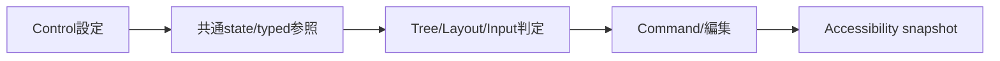

# SEP-D15 / DD-15 初期Controlの責務分離レビュー案

- 文書版: 0.2
- 状態: 全案反映承認済み・正本適用済み（2026-10-17）。具体化未了は適用結果を参照
- 作成日: 2026-10-17
- 対象: [元文書](../../13_detail_design/15-controls-v1.md)
- 対象箇所: DD-15 DD-CONTROL-01～12、§4/7/9
- 索引: [一括レビュー](index.md)
- 台帳項目: D15

- 現行要求根拠: [RQ-09-001](../../11_requirements/RQ-09_ui-scope.md#rq-09-001)、[RQ-09-002](../../11_requirements/RQ-09_ui-scope.md#rq-09-002)、[RQ-09-003](../../11_requirements/RQ-09_ui-scope.md#rq-09-003)、[RQ-09-004](../../11_requirements/RQ-09_ui-scope.md#rq-09-004)、[RQ-09-005](../../11_requirements/RQ-09_ui-scope.md#rq-09-005)、[RQ-09-006](../../11_requirements/RQ-09_ui-scope.md#rq-09-006)、[RQ-09-007](../../11_requirements/RQ-09_ui-scope.md#rq-09-007)、[RQ-09-008](../../11_requirements/RQ-09_ui-scope.md#rq-09-008)、[RQ-09-009](../../11_requirements/RQ-09_ui-scope.md#rq-09-009)、[RQ-09-010](../../11_requirements/RQ-09_ui-scope.md#rq-09-010)、[RQ-09-011](../../11_requirements/RQ-09_ui-scope.md#rq-09-011)、[RQ-10-003](../../11_requirements/RQ-10_accessibility.md#rq-10-003)、[RQ-10-008](../../11_requirements/RQ-10_accessibility.md#rq-10-008)
- 具体化する基本設計: [BD-04](../../12_design/BD-04_ui-tree-lifetime-upper-design.md)、[BD-06](../../12_design/BD-06_layout-upper-design.md)、[BD-07](../../12_design/BD-07_input-event-boundary-upper-design.md)、[BD-08](../../12_design/BD-08_focus-upper-design.md)、[BD-11](../../12_design/BD-11_initial-control-contract-upper-design.md)、[BD-12](../../12_design/BD-12_rendering-platform-upper-design.md)、[BD-13](../../12_design/BD-13_accessibility-upper-design.md)
## 対象本文と既存承認

- 状態: 承認済み（2026-10-12、DD-CONTROL-01～12）

作成時点の原文SHA-256: `ddecaeed7d62f2eb757e53417c3c2db96fee85fa5a8057937f1c3d9661f0fe13`。対象は台帳の箇所と、以下の原文・判断ID。正本の本文は今回編集していない。

原文 DD-CONTROL-03 / L38:

> Widgetはown `IsEnabled` BOOL（既定true）を持ち、effective enabledは自分と全Logical ancestorのenabledの論理積とする案。親を無効化しても子のown値は変更しない。effective値はInput/Focus、Button execute可否、Accessibility stateで共有する。

原文 DD-CONTROL-04 / L39:

> `Focusable`はWidgetごとに扱い、初期既定をTextBox/Button=true、Text/StackPanel/Window=falseとする。Window active/focus状態は子Controlのkeyboard focusと区別する。明示FocusableをContainerに付けた場合の実挙動は後続scope設計へ送る。

原文 DD-CONTROL-05 / L40:

> 初期Controlには共通`IsVisible`/Hidden/Collapsed APIを追加せず、画面から外す操作はLogical Treeからのremoveで行う案。visibilityによるMeasure/Focus/Accessibility eligibilityを暗黙に作らない。

原文 DD-CONTROL-11 / L46:

> Buttonのeffective executable stateを`IsEnabled && assigned Command exists && Command.can_execute`とする案。disabled状態のactivationはCommand.executeへ進まず、実行中の二度押しもDD-10の実行可否規則に従う。CommandなしのButtonを表示・無操作にするか、生成/設定を拒否するかは選択肢として確認する。

## 改訂判断案

| レビューID | 変更対象 | 提案 |
|---|---|---|
| SEP-D15-01 | 外部契約と要求の根拠 | [SEP-RQ-035 StackPanel公開設定と既定](rq-candidates.md#candidate-035)、[SEP-RQ-036 有効性とFocusの共通結果](rq-candidates.md#candidate-036)、[SEP-RQ-037 初期機能の除外とButton未接続](rq-candidates.md#candidate-037)、[SEP-RQ-041 Accessibility nameの空欄](rq-candidates.md#candidate-041)へ対応付ける。既存RQで定まる結果は上流参照にし、補足/選択要は要求承認後に設計前提へ反映する |
| SEP-D15-02 | 実現手段の本文 | 下記の責務・data/ownership flow・stateを本文案として収録する。個別の公開名・signatureを新たに確定する判断とは分ける |
| SEP-D15-03 | 未決・承認粒度 | DD-CONTROL-03/04/05/11の本文と§7未決を文単位で分ける。Commandなしの結果、ancestor enabled、Focusable初期値、visibility/直接Click範囲はRQレビューを要する。 |

## 設計本文の改訂案

初期Controlは共通Widget状態と各機能へのtyped参照を持つ。Containerのchild操作はTree commitへ、StackPanel設定はLayoutへ、TextBox候補は編集transactionへ接続する。Buttonは同Runtimeのoptional Command参照を保持し、effective enabledとCommand.can_executeを評価して一つのsemantic activation経路からexecuteする。Accessibilityも同じ意味状態を読む。

## 移管・ID・検証への影響

- 既存ID: DD-CONTROL-01、DD-CONTROL-02、DD-CONTROL-03、DD-CONTROL-04、DD-CONTROL-05、DD-CONTROL-06、DD-CONTROL-07、DD-CONTROL-08、DD-CONTROL-09、DD-CONTROL-10、DD-CONTROL-11、DD-CONTROL-12。方式として残る意味は旧IDを維持し、要求へ分ける文だけを仮候補IDに対応付ける。正式RQ IDの発番は[移行案](id-migration.md)による。
- 移管先: 利用者可視条件は上記RQ候補、C/言語APIの具体形はDD内、脅威と防御はSD、試験操作と判定手順はrequirements-test/unit-test、着手順と下流割当はto-do。
- 設計を説明する所有・state・call図と計算例は保持する。対象本文の試験節は、[検証改訂案](test-impact.md)へ対応付けてから移す。失敗時の状態表・cleanup順まで検証扱いで削除しない。
- 上流RQ/ADR/BDへの参照は該当記述に直接置く。後続の着手割当は計画へ移し、DD間のinterface依存参照は実際の定義側へ向けて循環を解く。文書番号の大小だけで依存を判定しない。

## 承認履歴

| 日付 | 対象 | 承認者 | 結果 |
|---|---|---|---|
| 2026-10-17 | SEP-D15 | — | 一括作成指示に基づくレビュー案。採用・正本適用は未承認 |

## 改訂履歴

| 版 | 日付 | 内容 | 状態 |
|---|---|---|---|
| 0.1 | 2026-10-17 | 現行文書から責務分離・改訂文案・影響を作成 | レビュー待ち |

## 2026-10-17 適用結果

[適用先](../../13_detail_design/15-controls-v1.md) の版0.1へ反映した。補足要求は正式IDへ対応付け、未設計事項は [後続課題](../requirements-design-separation-follow-up.md) に移した。

### 承認履歴

| 日付 | 範囲 | 承認者 | 結果 |
| --- | --- | --- | --- |
| 2026-10-17 | 全レビュー案の反映 | 利用者 | 「すべて反映して下さい。」により採用・正本適用を承認 |

### 改訂履歴

| 版 | 日付 | 内容 |
| --- | --- | --- |
| 0.2 | 2026-10-17 | 承認と正本適用結果を追記。作成時点の比較・引用を保持 |
