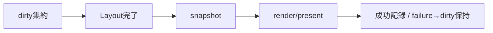

# SEP-D16 / DD-16 描画とPlatform Adapterの責務分離レビュー案

- 文書版: 0.2
- 状態: 全案反映承認済み・正本適用済み（2026-10-17）。具体化未了は適用結果を参照
- 作成日: 2026-10-17
- 対象: [元文書](../../13_detail_design/16-platform-rendering.md)
- 対象箇所: DD-16 DD-PLAT-01～10、§3～5/7/9
- 索引: [一括レビュー](index.md)
- 台帳項目: D16

- 現行要求根拠: [RQ-05-009](../../11_requirements/RQ-05_ownership-callbacks.md#rq-05-009)、[RQ-06-002](../../11_requirements/RQ-06_threading-dispatch.md#rq-06-002)、[RQ-09-005](../../11_requirements/RQ-09_ui-scope.md#rq-09-005)、[RQ-11-001](../../11_requirements/RQ-11_platform.md#rq-11-001)、[RQ-11-002](../../11_requirements/RQ-11_platform.md#rq-11-002)、[RQ-11-008](../../11_requirements/RQ-11_platform.md#rq-11-008)、[RQ-11-009](../../11_requirements/RQ-11_platform.md#rq-11-009)、[RQ-11-010](../../11_requirements/RQ-11_platform.md#rq-11-010)、[RQ-11-011](../../11_requirements/RQ-11_platform.md#rq-11-011)、[RQ-11-012](../../11_requirements/RQ-11_platform.md#rq-11-012)、[RQ-11-013](../../11_requirements/RQ-11_platform.md#rq-11-013)、[RQ-12-010](../../11_requirements/RQ-12_build-distribution.md#rq-12-010)、[RQ-15-002](../../11_requirements/RQ-15_requirement-decisions.md#rq-15-002)、[RQ-15-003](../../11_requirements/RQ-15_requirement-decisions.md#rq-15-003)、[RQ-15-006](../../11_requirements/RQ-15_requirement-decisions.md#rq-15-006)
- 具体化する基本設計: [BD-04](../../12_design/BD-04_ui-tree-lifetime-upper-design.md)、[BD-06](../../12_design/BD-06_layout-upper-design.md)、[BD-07](../../12_design/BD-07_input-event-boundary-upper-design.md)、[BD-09](../../12_design/BD-09_ime-focus-transition-upper-design.md)、[BD-11](../../12_design/BD-11_initial-control-contract-upper-design.md)、[BD-12](../../12_design/BD-12_rendering-platform-upper-design.md)、[BD-13](../../12_design/BD-13_accessibility-upper-design.md)、[BD-23](../../12_design/BD-23_text-shaping-upper-design.md)、[BD-36](../../12_design/BD-36_runtime-shutdown-dispatch-upper-design.md)
## 対象本文と既存承認

- 状態: 承認済み（2026-10-12、DD-PLAT-01～10）

作成時点の原文SHA-256: `d81f881634195d7d7c3f9f8edd7a7e5af6e2ac046ea7453a31a0323032fa6d56`。対象は台帳の箇所と、以下の原文・判断ID。正本の本文は今回編集していない。

原文 DD-PLAT-01 / L27:

> Core、共通Renderer、Platform Adapterを分離する。Coreが意味情報とLayout結果を確定し、RendererはCoreから与えられるVisual snapshotを描画し、AdapterはOS surface/device/eventとの接続を担う。OS native controlをControl状態のsource-of-truthにしない。

原文 DD-PLAT-02 / L28:

> ひとつのRuntimeは初期構成で一つのPlatform Adapter/backendに接続する。開かれたCore Windowごとに0または1つのAdapter-owned Window peerを対応させ、peerがnative window/surfaceとgraphics resourceを保持する。Core Windowとpeerは別object/寿命とし、WindowのDetached状態だけではpeerを暗黙破棄しない。

原文 DD-PLAT-03 / L29:

> Visual/Property/Tree/Layout変更はCore dirty stateへ集約する。描画frameを作る直前に必要なMeasure/Arrangeを完了し、同じUI thread上の一貫したVisual/Layout/Control snapshotをRendererへ渡す。連続したdirty要求・resizeは未開始frameに集約し、部分更新に失敗した場合は前回のcomplete frame相当状態を保持する。

原文 DD-PLAT-04 / L30:

> Frame requestと通常post/input/notificationはDD-03のbounded UI dispatch内で処理する。shutdown control taskは実行中callback/eventが戻った次の処理機会でframe/通常workより優先し、開始済みrender/host eventを途中で再入終了させない。描画要求が続いても同じdispatch turnを無制限に占有しない。

## 改訂判断案

| レビューID | 変更対象 | 提案 |
|---|---|---|
| SEP-D16-01 | 外部契約と要求の根拠 | [SEP-RQ-008 callback/event中の終了要求](rq-candidates.md#candidate-008)、[SEP-RQ-009 終了要求の受付と完了](rq-candidates.md#candidate-009)、[SEP-RQ-010 停止したUI loopへの同期要求](rq-candidates.md#candidate-010)、[SEP-RQ-029 IME commit準備失敗](rq-candidates.md#candidate-029)、[SEP-RQ-039 Platform資源喪失と終了](rq-candidates.md#candidate-039)、[SEP-RQ-049 検証状態と正式support](rq-candidates.md#candidate-049)へ対応付ける。既存RQで定まる結果は上流参照にし、補足/選択要は要求承認後に設計前提へ反映する |
| SEP-D16-02 | 実現手段の本文 | 下記の責務・data/ownership flow・stateを本文案として収録する。個別の公開名・signatureを新たに確定する判断とは分ける |
| SEP-D16-03 | 未決・承認粒度 | close accept/veto/defer、再表示、software fallback、priority adapter能力、停止loop handshakeは未決を維持する。正式support matrixはRQ/検証証拠と別に追跡する。 |

## 設計本文の改訂案

Platform AdapterがWindow peer/surface/deviceを所有し、Core Windowの意味寿命と分離する。frame前にdirty Layoutを解決し、一貫したVisual snapshotをRendererへ渡す。failureではdirtyを維持し、peer喪失中のevent配送を止める。shutdownは新規event/frame受付停止→IME session終了→peer/graphics破棄→Core参照解放の順でUI thread上に集約する。

## 移管・ID・検証への影響

- 既存ID: DD-PLAT-01、DD-PLAT-02、DD-PLAT-03、DD-PLAT-04、DD-PLAT-05、DD-PLAT-06、DD-PLAT-07、DD-PLAT-08、DD-PLAT-09、DD-PLAT-10。方式として残る意味は旧IDを維持し、要求へ分ける文だけを仮候補IDに対応付ける。正式RQ IDの発番は[移行案](id-migration.md)による。
- 移管先: 利用者可視条件は上記RQ候補、C/言語APIの具体形はDD内、脅威と防御はSD、試験操作と判定手順はrequirements-test/unit-test、着手順と下流割当はto-do。
- 設計を説明する所有・state・call図と計算例は保持する。対象本文の試験節は、[検証改訂案](test-impact.md)へ対応付けてから移す。失敗時の状態表・cleanup順まで検証扱いで削除しない。
- 上流RQ/ADR/BDへの参照は該当記述に直接置く。後続の着手割当は計画へ移し、DD間のinterface依存参照は実際の定義側へ向けて循環を解く。文書番号の大小だけで依存を判定しない。

## 承認履歴

| 日付 | 対象 | 承認者 | 結果 |
|---|---|---|---|
| 2026-10-17 | SEP-D16 | — | 一括作成指示に基づくレビュー案。採用・正本適用は未承認 |

## 改訂履歴

| 版 | 日付 | 内容 | 状態 |
|---|---|---|---|
| 0.1 | 2026-10-17 | 現行文書から責務分離・改訂文案・影響を作成 | レビュー待ち |

## 2026-10-17 適用結果

[適用先](../../13_detail_design/16-platform-rendering.md) の版0.1へ反映した。補足要求は正式IDへ対応付け、未設計事項は [後続課題](../requirements-design-separation-follow-up.md) に移した。

### 承認履歴

| 日付 | 範囲 | 承認者 | 結果 |
| --- | --- | --- | --- |
| 2026-10-17 | 全レビュー案の反映 | 利用者 | 「すべて反映して下さい。」により採用・正本適用を承認 |

### 改訂履歴

| 版 | 日付 | 内容 |
| --- | --- | --- |
| 0.2 | 2026-10-17 | 承認と正本適用結果を追記。作成時点の比較・引用を保持 |
