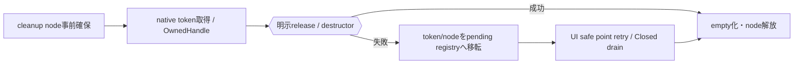

# SEP-D18 / DD-18 C++ wrapperの責務分離レビュー案

- 文書版: 0.2
- 状態: 全案反映承認済み・正本適用済み（2026-10-17）。具体化未了は適用結果を参照
- 作成日: 2026-10-17
- 対象: [元文書](../../13_detail_design/18-wrapper-cpp.md)
- 対象箇所: DD-18 DD-CPP-01～15、§3～9
- 索引: [一括レビュー](index.md)
- 台帳項目: D18

- 現行要求根拠: [RQ-03-001](../../11_requirements/RQ-03_language-support.md#rq-03-001)、[RQ-04-006](../../11_requirements/RQ-04_abi-boundary.md#rq-04-006)、[RQ-04-007](../../11_requirements/RQ-04_abi-boundary.md#rq-04-007)、[RQ-04-016](../../11_requirements/RQ-04_abi-boundary.md#rq-04-016)、[RQ-05-003](../../11_requirements/RQ-05_ownership-callbacks.md#rq-05-003)、[RQ-05-009](../../11_requirements/RQ-05_ownership-callbacks.md#rq-05-009)、[RQ-06-002](../../11_requirements/RQ-06_threading-dispatch.md#rq-06-002)
- 具体化する基本設計: [BD-01](../../12_design/BD-01_value-types-upper-design.md)、[BD-36](../../12_design/BD-36_runtime-shutdown-dispatch-upper-design.md)
## 対象本文と既存承認

- 状態: DD-CPP-01～15承認済み（2026-10-12）

作成時点の原文SHA-256: `76be9747578f988dbd79463eaf54bc5b83d6d5b6fac13d6793549d1d5e155e34`。対象は台帳の箇所と、以下の原文・判断ID。正本の本文は今回編集していない。

原文 DD-CPP-01 / L29:

> すべての公開handle wrapperは内部にopaque `ui_handle` tokenを持ち、token整数・native pointerへの暗黙変換を提供しない。wrapperは期待kindとRuntime関連を型/内部検証で守り、最終的な検証statusはCoreの結果を保持する。

原文 DD-CPP-02 / L30:

> 所有tokenを持つ低層wrapperはmove-onlyとし、destructorで一token分の`handle_release`を試みる。所有tokenの複製は`handle_retain`を呼ぶ明示操作（例示名 `clone()`）だけで行う。借用handleは呼出し中のみ有効な非所有viewとして渡し、破棄時にreleaseしない。

原文 DD-CPP-03 / L31:

> `close()` / `reset()`等の明示終了操作はstatus/errorを呼出し側へ返せる形にし、成功時だけ所有tokenを空にする。RAII destructorは例外を投げず、release成功時にtokenを空にし、失敗時はDD-CPP-15の言語内cleanup管理へ所有tokenを移す。

原文 DD-CPP-04 / L32:

> C++ callback captureは安定したheap stateに置き、C trampolineがそれを取り出して呼ぶ。C APIの登録/postが失敗した場合、所有権をCoreへ渡さずwrapperがstateを解放する。成功時はCoreのdestroy thunkがstateを一度だけ解放する。

## 改訂判断案

| レビューID | 変更対象 | 提案 |
|---|---|---|
| SEP-D18-01 | 外部契約と要求の根拠 | [SEP-RQ-005 破棄失敗時の参照保全](rq-candidates.md#candidate-005)、[SEP-RQ-008 callback/event中の終了要求](rq-candidates.md#candidate-008)、[SEP-RQ-009 終了要求の受付と完了](rq-candidates.md#candidate-009)、[SEP-RQ-017 error詳細を生成できない失敗](rq-candidates.md#candidate-017)、[SEP-RQ-018 利用者定義エラーの自動採番](rq-candidates.md#candidate-018)、[SEP-RQ-042 C++の例外無効buildとhandler](rq-candidates.md#candidate-042)へ対応付ける。既存RQで定まる結果は上流参照にし、補足/選択要は要求承認後に設計前提へ反映する |
| SEP-D18-02 | 実現手段の本文 | 下記の責務・data/ownership flow・stateを本文案として収録する。個別の公開名・signatureを新たに確定する判断とは分ける |
| SEP-D18-03 | 未決・承認粒度 | result/handlerの正式型、handler交換時同期、最低C++標準、C++共有Runtime ownerの形はAPI/support未決。Core release失敗契約をwrapper都合で変更しない。 |

## 設計本文の改訂案

OwnedHandleはnative token取得前にcleanup nodeを確保し、明示retain成功でだけ新ownerを作る。moveはtoken/nodeの所有を一度移し、borrow viewはcall期間だけ参照する。destructorのrelease失敗ではnode/tokenをpending registryへ移し、UI safe pointでretryし、Closed shell drain後にRuntime anchorを解放する。noexcept trampolineは例外をhandlerと種別固有failureへ変換する。

## 移管・ID・検証への影響

- 既存ID: DD-CPP-01、DD-CPP-02、DD-CPP-03、DD-CPP-04、DD-CPP-05、DD-CPP-06、DD-CPP-07、DD-CPP-08、DD-CPP-09、DD-CPP-10、DD-CPP-11、DD-CPP-12、DD-CPP-13、DD-CPP-14、DD-CPP-15。方式として残る意味は旧IDを維持し、要求へ分ける文だけを仮候補IDに対応付ける。正式RQ IDの発番は[移行案](id-migration.md)による。
- 移管先: 利用者可視条件は上記RQ候補、C/言語APIの具体形はDD内、脅威と防御はSD、試験操作と判定手順はrequirements-test/unit-test、着手順と下流割当はto-do。
- 設計を説明する所有・state・call図と計算例は保持する。対象本文の試験節は、[検証改訂案](test-impact.md)へ対応付けてから移す。失敗時の状態表・cleanup順まで検証扱いで削除しない。
- 上流RQ/ADR/BDへの参照は該当記述に直接置く。後続の着手割当は計画へ移し、DD間のinterface依存参照は実際の定義側へ向けて循環を解く。文書番号の大小だけで依存を判定しない。

## 承認履歴

| 日付 | 対象 | 承認者 | 結果 |
|---|---|---|---|
| 2026-10-17 | SEP-D18 | — | 一括作成指示に基づくレビュー案。採用・正本適用は未承認 |

## 改訂履歴

| 版 | 日付 | 内容 | 状態 |
|---|---|---|---|
| 0.1 | 2026-10-17 | 現行文書から責務分離・改訂文案・影響を作成 | レビュー待ち |

## 2026-10-17 適用結果

[適用先](../../13_detail_design/18-wrapper-cpp.md) の版0.1へ反映した。補足要求は正式IDへ対応付け、未設計事項は [後続課題](../requirements-design-separation-follow-up.md) に移した。

### 承認履歴

| 日付 | 範囲 | 承認者 | 結果 |
| --- | --- | --- | --- |
| 2026-10-17 | 全レビュー案の反映 | 利用者 | 「すべて反映して下さい。」により採用・正本適用を承認 |

### 改訂履歴

| 版 | 日付 | 内容 |
| --- | --- | --- |
| 0.2 | 2026-10-17 | 承認と正本適用結果を追記。作成時点の比較・引用を保持 |
