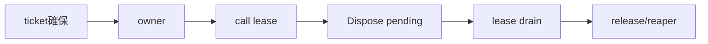

# SEP-D19 / DD-19 C# wrapperの責務分離レビュー案

- 文書版: 0.2
- 状態: 全案反映承認済み・正本適用済み（2026-10-17）。具体化未了は適用結果を参照
- 作成日: 2026-10-17
- 対象: [元文書](../../13_detail_design/19-wrapper-csharp.md)
- 対象箇所: DD-19 DD-CS-01～14、§3～10
- 索引: [一括レビュー](index.md)
- 台帳項目: D19

- 現行要求根拠: [RQ-03-002](../../11_requirements/RQ-03_language-support.md#rq-03-002)、[RQ-04-006](../../11_requirements/RQ-04_abi-boundary.md#rq-04-006)、[RQ-04-007](../../11_requirements/RQ-04_abi-boundary.md#rq-04-007)、[RQ-05-003](../../11_requirements/RQ-05_ownership-callbacks.md#rq-05-003)、[RQ-05-009](../../11_requirements/RQ-05_ownership-callbacks.md#rq-05-009)、[RQ-06-002](../../11_requirements/RQ-06_threading-dispatch.md#rq-06-002)、[RQ-12-006](../../11_requirements/RQ-12_build-distribution.md#rq-12-006)
- 具体化する基本設計: [BD-01](../../12_design/BD-01_value-types-upper-design.md)、[BD-16](../../12_design/BD-16_build-ci-target-matrix-upper-design.md)、[BD-18](../../12_design/BD-18_csharp-nuget-native-assets-upper-design.md)、[BD-36](../../12_design/BD-36_runtime-shutdown-dispatch-upper-design.md)
## 対象本文と既存承認

- 状態: DD-CS-01～14承認済み（2026-10-12）

作成時点の原文SHA-256: `8dc480f42a78d555c532db0fad9efc1d827a4f63215ece5577022e8923c51744`。対象は台帳の箇所と、以下の原文・判断ID。正本の本文は今回編集していない。

原文 DD-CS-01 / L26:

> Native interop declarationはC ABIと同じfixed-width typesを使う。`ui_handle`は`ulong`として値を保ち、`IntPtr`をC ABI handle表現やnative object pointerとして扱わない。C callback/userdataのpointer引数だけを`IntPtr`等のpointer-sized表現にする。

原文 DD-CS-02 / L27:

> 公開managed wrapperは`IDisposable`を実装し、明示`Dispose`/`Close`でtoken releaseまたはAPI固有deactivateを行う。Disposeは冪等とし、成功したrelease後だけtokenをemptyにする。finalizerは明示cleanupの代用にしない。

原文 DD-CS-03 / L28:

> P/Invoke中のowner Dispose/release競合を避けるため、各native callはhandle lifetime leaseを取得し、call return後に解放する。leaseを持つcallが終了するまで最後のtoken releaseを開始しない。callbackからの再入Disposeもdeadlockさせない実装にする。

原文 DD-CS-04 / L29:

> `SafeHandle`は候補として調べるが、`ReleaseHandle`をCore releaseの単純な一回呼出しにしない。release失敗可能性に対して、事前確保済みcleanup ticketをC#側registryへ移管できる場合に限り利用する。代替ownerでも同じno-loss・retry契約を満たす。

## 改訂判断案

| レビューID | 変更対象 | 提案 |
|---|---|---|
| SEP-D19-01 | 外部契約と要求の根拠 | [SEP-RQ-005 破棄失敗時の参照保全](rq-candidates.md#candidate-005)、[SEP-RQ-008 callback/event中の終了要求](rq-candidates.md#candidate-008)、[SEP-RQ-009 終了要求の受付と完了](rq-candidates.md#candidate-009)、[SEP-RQ-017 error詳細を生成できない失敗](rq-candidates.md#candidate-017)、[SEP-RQ-018 利用者定義エラーの自動採番](rq-candidates.md#candidate-018)、[SEP-RQ-043 C#の明示破棄と競合](rq-candidates.md#candidate-043)へ対応付ける。既存RQで定まる結果は上流参照にし、補足/選択要は要求承認後に設計前提へ反映する |
| SEP-D19-02 | 実現手段の本文 | 下記の責務・data/ownership flow・stateを本文案として収録する。個別の公開名・signatureを新たに確定する判断とは分ける |
| SEP-D19-03 | 未決・承認粒度 | SafeHandle/代替owner、TFM/interop generator、handler/try APIは未決を維持。64-bit tokenにIntPtrを無条件適用しない。C++固有例外無効要求を移植しない。 |

## 設計本文の改訂案

managed ownerはtokenと事前確保cleanup ticketを保持し、P/Invoke開始時にleaseを取得する。Disposeは新規leaseを止め、既存call終了後にreleaseする。失敗時はticketがtokenを保持してreaperへ移る。static trampolineとGCHandle相当rootは登録成功後のCore closure寿命に対応付け、最後のinvoke後のdestroyで回収する。

## 移管・ID・検証への影響

- 既存ID: DD-CS-01、DD-CS-02、DD-CS-03、DD-CS-04、DD-CS-05、DD-CS-06、DD-CS-07、DD-CS-08、DD-CS-09、DD-CS-10、DD-CS-11、DD-CS-12、DD-CS-13、DD-CS-14。方式として残る意味は旧IDを維持し、要求へ分ける文だけを仮候補IDに対応付ける。正式RQ IDの発番は[移行案](id-migration.md)による。
- 移管先: 利用者可視条件は上記RQ候補、C/言語APIの具体形はDD内、脅威と防御はSD、試験操作と判定手順はrequirements-test/unit-test、着手順と下流割当はto-do。
- 設計を説明する所有・state・call図と計算例は保持する。対象本文の試験節は、[検証改訂案](test-impact.md)へ対応付けてから移す。失敗時の状態表・cleanup順まで検証扱いで削除しない。
- 上流RQ/ADR/BDへの参照は該当記述に直接置く。後続の着手割当は計画へ移し、DD間のinterface依存参照は実際の定義側へ向けて循環を解く。文書番号の大小だけで依存を判定しない。

## 承認履歴

| 日付 | 対象 | 承認者 | 結果 |
|---|---|---|---|
| 2026-10-17 | SEP-D19 | — | 一括作成指示に基づくレビュー案。採用・正本適用は未承認 |

## 改訂履歴

| 版 | 日付 | 内容 | 状態 |
|---|---|---|---|
| 0.1 | 2026-10-17 | 現行文書から責務分離・改訂文案・影響を作成 | レビュー待ち |

## 2026-10-17 適用結果

[適用先](../../13_detail_design/19-wrapper-csharp.md) の版0.1へ反映した。補足要求は正式IDへ対応付け、未設計事項は [後続課題](../requirements-design-separation-follow-up.md) に移した。

### 承認履歴

| 日付 | 範囲 | 承認者 | 結果 |
| --- | --- | --- | --- |
| 2026-10-17 | 全レビュー案の反映 | 利用者 | 「すべて反映して下さい。」により採用・正本適用を承認 |

### 改訂履歴

| 版 | 日付 | 内容 |
| --- | --- | --- |
| 0.2 | 2026-10-17 | 承認と正本適用結果を追記。作成時点の比較・引用を保持 |
