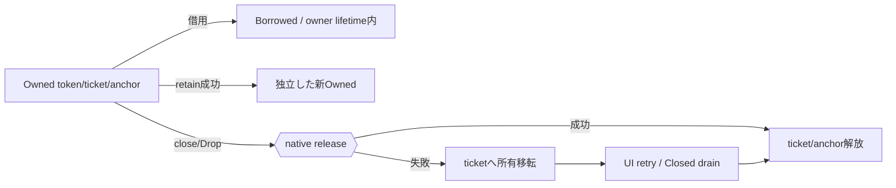

# SEP-D20 / DD-20 Rust safe APIの責務分離レビュー案

- 文書版: 0.2
- 状態: 全案反映承認済み・正本適用済み（2026-10-17）。具体化未了は適用結果を参照
- 作成日: 2026-10-17
- 対象: [元文書](../../13_detail_design/20-wrapper-rust.md)
- 対象箇所: DD-20 DD-RS-01～15、§3～10
- 索引: [一括レビュー](index.md)
- 台帳項目: D20

- 現行要求根拠: [RQ-03-003](../../11_requirements/RQ-03_language-support.md#rq-03-003)、[RQ-04-006](../../11_requirements/RQ-04_abi-boundary.md#rq-04-006)、[RQ-04-007](../../11_requirements/RQ-04_abi-boundary.md#rq-04-007)、[RQ-04-015](../../11_requirements/RQ-04_abi-boundary.md#rq-04-015)、[RQ-05-003](../../11_requirements/RQ-05_ownership-callbacks.md#rq-05-003)、[RQ-05-009](../../11_requirements/RQ-05_ownership-callbacks.md#rq-05-009)、[RQ-06-002](../../11_requirements/RQ-06_threading-dispatch.md#rq-06-002)、[RQ-12-005](../../11_requirements/RQ-12_build-distribution.md#rq-12-005)
- 具体化する基本設計: [BD-01](../../12_design/BD-01_value-types-upper-design.md)、[BD-16](../../12_design/BD-16_build-ci-target-matrix-upper-design.md)、[BD-20](../../12_design/BD-20_rust-cargo-package-upper-design.md)、[BD-27](../../12_design/BD-27_error-object-upper-design.md)、[BD-36](../../12_design/BD-36_runtime-shutdown-dispatch-upper-design.md)
## 対象本文と既存承認

- 状態: DD-RS-01～15承認済み（2026-10-12）

作成時点の原文SHA-256: `975c2e18f7e4a9d95574420f80a23e8c173eb40600f9a08f523818e5db5a4249`。対象は台帳の箇所と、以下の原文・判断ID。正本の本文は今回編集していない。

原文 DD-RS-01 / L26:

> Rust wrapperをraw FFI `-sys` crateとsafe wrapper crateに分ける。Safe crateは通常利用時にraw pointer、userdata、C ABI関数呼出しを露出しない。

原文 DD-RS-02 / L27:

> safe wrapperが所有するC ABI tokenはmove-only相当のowner型で包む。ownerの暗黙`Copy`/`Clone`を認めず、明示的なretain操作が成功したときだけ独立した新tokenを持つownerを返す。

原文 DD-RS-03 / L28:

> 借用handleはownerからの借用として表し、呼出しスコープを越えて保存・releaseできない。異なるRuntimeに属するhandleの組合せはsafe wrapper内でも検証し、最終的なkind/Runtime検証はCoreのstatusを保持する。

原文 DD-RS-04 / L29:

> owned wrapperの明示終了操作は失敗を`Result`相当で返し、release成功時のみownerをemptyにする。失敗時はtoken ownershipをowner側へ残し再試行可能とする。

## 改訂判断案

| レビューID | 変更対象 | 提案 |
|---|---|---|
| SEP-D20-01 | 外部契約と要求の根拠 | [SEP-RQ-005 破棄失敗時の参照保全](rq-candidates.md#candidate-005)、[SEP-RQ-008 callback/event中の終了要求](rq-candidates.md#candidate-008)、[SEP-RQ-009 終了要求の受付と完了](rq-candidates.md#candidate-009)、[SEP-RQ-017 error詳細を生成できない失敗](rq-candidates.md#candidate-017)、[SEP-RQ-018 利用者定義エラーの自動採番](rq-candidates.md#candidate-018)、[SEP-RQ-044 Rust safe APIとpanic限界](rq-candidates.md#candidate-044)へ対応付ける。既存RQで定まる結果は上流参照にし、補足/選択要は要求承認後に設計前提へ反映する |
| SEP-D20-02 | 実現手段の本文 | 下記の責務・data/ownership flow・stateを本文案として収録する。個別の公開名・signatureを新たに確定する判断とは分ける |
| SEP-D20-03 | 未決・承認粒度 | 所有移転表・Mermaid図を保持。panic=unwind捕捉とpanic=abort/二重panicの限界はRQへ。MSRV/edition/crate名/poison recovery/public receiver形は未決。 |

## 設計本文の改訂案

safe Owned型はtoken/ticket/Runtime anchorを所有し、Borrowed型はowner lifetimeに束縛する。明示retainは失敗可能な新owner取得とし、Dropはrelease失敗時に事前ticketへ所有を移してUI retryへ渡す。UI-affine ownerはSend/Syncを抑止し、worker用Dispatcherの同期済み経路でSendなclosureだけを移送する。登録成功時のuserdata所有とdestroy回収をFFI unsafe内部に閉じる。

## 移管・ID・検証への影響

- 既存ID: DD-RS-01、DD-RS-02、DD-RS-03、DD-RS-04、DD-RS-05、DD-RS-06、DD-RS-07、DD-RS-08、DD-RS-09、DD-RS-10、DD-RS-11、DD-RS-12、DD-RS-13、DD-RS-14、DD-RS-15。方式として残る意味は旧IDを維持し、要求へ分ける文だけを仮候補IDに対応付ける。正式RQ IDの発番は[移行案](id-migration.md)による。
- 移管先: 利用者可視条件は上記RQ候補、C/言語APIの具体形はDD内、脅威と防御はSD、試験操作と判定手順はrequirements-test/unit-test、着手順と下流割当はto-do。
- 設計を説明する所有・state・call図と計算例は保持する。対象本文の試験節は、[検証改訂案](test-impact.md)へ対応付けてから移す。失敗時の状態表・cleanup順まで検証扱いで削除しない。
- 上流RQ/ADR/BDへの参照は該当記述に直接置く。後続の着手割当は計画へ移し、DD間のinterface依存参照は実際の定義側へ向けて循環を解く。文書番号の大小だけで依存を判定しない。

## 承認履歴

| 日付 | 対象 | 承認者 | 結果 |
|---|---|---|---|
| 2026-10-17 | SEP-D20 | — | 一括作成指示に基づくレビュー案。採用・正本適用は未承認 |

## 改訂履歴

| 版 | 日付 | 内容 | 状態 |
|---|---|---|---|
| 0.1 | 2026-10-17 | 現行文書から責務分離・改訂文案・影響を作成 | レビュー待ち |

## 2026-10-17 適用結果

[適用先](../../13_detail_design/20-wrapper-rust.md) の版0.1へ反映した。補足要求は正式IDへ対応付け、未設計事項は [後続課題](../requirements-design-separation-follow-up.md) に移した。

### 承認履歴

| 日付 | 範囲 | 承認者 | 結果 |
| --- | --- | --- | --- |
| 2026-10-17 | 全レビュー案の反映 | 利用者 | 「すべて反映して下さい。」により採用・正本適用を承認 |

### 改訂履歴

| 版 | 日付 | 内容 |
| --- | --- | --- |
| 0.2 | 2026-10-17 | 承認と正本適用結果を追記。作成時点の比較・引用を保持 |
