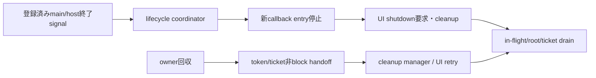

# SEP-D21 / DD-21 Python 3 wrapperの責務分離レビュー案

- 文書版: 0.2
- 状態: 全案反映承認済み・正本適用済み（2026-10-17）。具体化未了は適用結果を参照
- 作成日: 2026-10-17
- 対象: [元文書](../../13_detail_design/21-wrapper-python.md)
- 対象箇所: DD-21 DD-PY-01～21、§4.1/6/8/11/12
- 索引: [一括レビュー](index.md)
- 台帳項目: D21

- 現行要求根拠: [RQ-02-013](../../11_requirements/RQ-02_core-features.md#rq-02-013)、[RQ-03-004](../../11_requirements/RQ-03_language-support.md#rq-03-004)、[RQ-04-006](../../11_requirements/RQ-04_abi-boundary.md#rq-04-006)、[RQ-04-007](../../11_requirements/RQ-04_abi-boundary.md#rq-04-007)、[RQ-04-017](../../11_requirements/RQ-04_abi-boundary.md#rq-04-017)、[RQ-05-003](../../11_requirements/RQ-05_ownership-callbacks.md#rq-05-003)、[RQ-05-009](../../11_requirements/RQ-05_ownership-callbacks.md#rq-05-009)、[RQ-06-002](../../11_requirements/RQ-06_threading-dispatch.md#rq-06-002)、[RQ-06-003](../../11_requirements/RQ-06_threading-dispatch.md#rq-06-003)、[RQ-15-007](../../11_requirements/RQ-15_requirement-decisions.md#rq-15-007)、[RQ-15-013](../../11_requirements/RQ-15_requirement-decisions.md#rq-15-013)
- 具体化する基本設計: [BD-01](../../12_design/BD-01_value-types-upper-design.md)、[BD-14](../../12_design/BD-14_python-wrapper-upper-design.md)、[BD-15](../../12_design/BD-15_python-lint-mcp-upper-design.md)、[BD-16](../../12_design/BD-16_build-ci-target-matrix-upper-design.md)、[BD-17](../../12_design/BD-17_python-package-distribution-upper-design.md)、[BD-36](../../12_design/BD-36_runtime-shutdown-dispatch-upper-design.md)
## 対象本文と既存承認

- 状態: 承認済み（2026-10-12）

作成時点の原文SHA-256: `4ee34836435256a863813be52334cca3c081d9be9c76025630f72d346e969aa7`。対象は台帳の箇所と、以下の原文・判断ID。正本の本文は今回編集していない。

原文 DD-PY-06 / L32:

> Python ownerが回収されるときは、`__del__`または同等のfinalizerから所有tokenのcleanup要求を必ず引き渡す設計を候補とする。finalizerは事前確保ticket/token/Runtime anchorを非同期・非blockでcleanup managerへ移すだけとし、GC/finalizer threadからUI-affine native releaseを直接呼ばない。明示`close()`とcontext managerは早く確実な解放経路として併用する。

原文 DD-PY-13 / L39:

> worker threadから変更を許すPython wrapper state（owner状態、token/ticket所有移転、callback/Runtime registry等）は、GILの有無にかかわらず明示lockで保護する。workerから変更させないstateはread-only viewまたは値snapshotとして渡し、UI-affine stateの変更はUI threadへdispatchする。

原文 DD-PY-20 / L46:

> RuntimeはPython main/host threadの終了を検知してRuntime単位のlifecycle coordinatorへ通知し、全Runtimeへshutdown要求を送り、Python側callbackへの新規entryを止めたうえでnative UI loopを起床・終了させる経路を持つ案とする。

原文 DD-PY-21 / L47:

> Runtime lifecycle coordinatorは通常の終了経路を複数の通知点から受け付ける。

## 改訂判断案

| レビューID | 変更対象 | 提案 |
|---|---|---|
| SEP-D21-01 | 外部契約と要求の根拠 | [SEP-RQ-005 破棄失敗時の参照保全](rq-candidates.md#candidate-005)、[SEP-RQ-008 callback/event中の終了要求](rq-candidates.md#candidate-008)、[SEP-RQ-009 終了要求の受付と完了](rq-candidates.md#candidate-009)、[SEP-RQ-017 error詳細を生成できない失敗](rq-candidates.md#candidate-017)、[SEP-RQ-018 利用者定義エラーの自動採番](rq-candidates.md#candidate-018)、[SEP-RQ-045 Python明示終了とowner回収](rq-candidates.md#candidate-045)、[SEP-RQ-046 Python通常終了・例外と保証外](rq-candidates.md#candidate-046)、[SEP-RQ-047 GIL非依存とsupport区分](rq-candidates.md#candidate-047)、[SEP-RQ-048 診断・解析の能力と限界](rq-candidates.md#candidate-048)へ対応付ける。既存RQで定まる結果は上流参照にし、補足/選択要は要求承認後に設計前提へ反映する |
| SEP-D21-02 | 実現手段の本文 | 下記の責務・data/ownership flow・stateを本文案として収録する。個別の公開名・signatureを新たに確定する判断とは分ける |
| SEP-D21-03 | 未決・承認粒度 | __del__実行保証やos._exitの捕捉を約束しない。host/main終了検知の移植可能性と登録契約、例外hook合成、SystemExit経路、lock-free handoffの成立条件は設計gapを明記。GIL非依存とfree-threaded正式supportを分ける。 |

## 設計本文の改訂案

Python ownerのtoken/ticket状態とroot registryは明示lockで遷移させ、native callや利用者callback中はlockを保持しない。owner finalizerはmanagerへ短い非block handoffを行う。C destroyはroot recordをsafe-point release queueへ渡し、Python値の最終dropをC destroy stackから分離する。lifecycle coordinatorは明示終了・登録済みmain/host境界・loop終了通知等を集約し、新callback entry停止→UI wake/cleanup→root drainへ進める。

## 移管・ID・検証への影響

- 既存ID: DD-PY-01、DD-PY-02、DD-PY-03、DD-PY-04、DD-PY-05、DD-PY-06、DD-PY-07、DD-PY-08、DD-PY-09、DD-PY-10、DD-PY-11、DD-PY-12、DD-PY-13、DD-PY-14、DD-PY-15、DD-PY-16、DD-PY-17、DD-PY-18、DD-PY-19、DD-PY-20、DD-PY-21。方式として残る意味は旧IDを維持し、要求へ分ける文だけを仮候補IDに対応付ける。正式RQ IDの発番は[移行案](id-migration.md)による。
- 移管先: 利用者可視条件は上記RQ候補、C/言語APIの具体形はDD内、脅威と防御はSD、試験操作と判定手順はrequirements-test/unit-test、着手順と下流割当はto-do。
- 設計を説明する所有・state・call図と計算例は保持する。対象本文の試験節は、[検証改訂案](test-impact.md)へ対応付けてから移す。失敗時の状態表・cleanup順まで検証扱いで削除しない。
- 上流RQ/ADR/BDへの参照は該当記述に直接置く。後続の着手割当は計画へ移し、DD間のinterface依存参照は実際の定義側へ向けて循環を解く。文書番号の大小だけで依存を判定しない。

## 承認履歴

| 日付 | 対象 | 承認者 | 結果 |
|---|---|---|---|
| 2026-10-17 | SEP-D21 | — | 一括作成指示に基づくレビュー案。採用・正本適用は未承認 |

## 改訂履歴

| 版 | 日付 | 内容 | 状態 |
|---|---|---|---|
| 0.1 | 2026-10-17 | 現行文書から責務分離・改訂文案・影響を作成 | レビュー待ち |

## 2026-10-17 適用結果

[適用先](../../13_detail_design/21-wrapper-python.md) の版0.1へ反映した。補足要求は正式IDへ対応付け、未設計事項は [後続課題](../requirements-design-separation-follow-up.md) に移した。

### 承認履歴

| 日付 | 範囲 | 承認者 | 結果 |
| --- | --- | --- | --- |
| 2026-10-17 | 全レビュー案の反映 | 利用者 | 「すべて反映して下さい。」により採用・正本適用を承認 |

### 改訂履歴

| 版 | 日付 | 内容 |
| --- | --- | --- |
| 0.2 | 2026-10-17 | 承認と正本適用結果を追記。作成時点の比較・引用を保持 |
