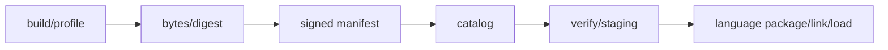

# SEP-D22 / DD-22 Buildと配布の責務分離レビュー案

- 文書版: 0.2
- 状態: 全案反映承認済み・正本適用済み（2026-10-17）。具体化未了は適用結果を参照
- 作成日: 2026-10-17
- 対象: [元文書](../../13_detail_design/22-build-distribution.md)
- 対象箇所: DD-22 DD-BUILD-01～11、§3～10/11
- 索引: [一括レビュー](index.md)
- 台帳項目: D22

- 現行要求根拠: [RQ-11-001](../../11_requirements/RQ-11_platform.md#rq-11-001)、[RQ-11-002](../../11_requirements/RQ-11_platform.md#rq-11-002)、[RQ-12-001](../../11_requirements/RQ-12_build-distribution.md#rq-12-001)、[RQ-12-003](../../11_requirements/RQ-12_build-distribution.md#rq-12-003)、[RQ-12-005](../../11_requirements/RQ-12_build-distribution.md#rq-12-005)、[RQ-12-010](../../11_requirements/RQ-12_build-distribution.md#rq-12-010)、[RQ-13-001](../../11_requirements/RQ-13_nonfunctional-measurement.md#rq-13-001)、[RQ-13-011](../../11_requirements/RQ-13_nonfunctional-measurement.md#rq-13-011)、[RQ-15-014](../../11_requirements/RQ-15_requirement-decisions.md#rq-15-014)、[RQ-15-015](../../11_requirements/RQ-15_requirement-decisions.md#rq-15-015)、[RQ-15-016](../../11_requirements/RQ-15_requirement-decisions.md#rq-15-016)、[RQ-15-017](../../11_requirements/RQ-15_requirement-decisions.md#rq-15-017)
- 具体化する基本設計: [BD-12](../../12_design/BD-12_rendering-platform-upper-design.md)、[BD-16](../../12_design/BD-16_build-ci-target-matrix-upper-design.md)、[BD-17](../../12_design/BD-17_python-package-distribution-upper-design.md)、[BD-20](../../12_design/BD-20_rust-cargo-package-upper-design.md)、[BD-22](../../12_design/BD-22_support-lifecycle-upper-design.md)、[BD-28](../../12_design/BD-28_abi-release-version-upper-design.md)、[BD-29](../../12_design/BD-29_artifact-provenance-upper-design.md)、[BD-32](../../12_design/BD-32_artifact-manifest-schema-upper-design.md)
## 対象本文と既存承認

- 状態: 利用者承認済み（DD-BUILD-01～11、2026-10-12）

作成時点の原文SHA-256: `b1b6c593dde3f78467924d4864b827e94ad8623d936258794c563ea5413966a0`。対象は台帳の箇所と、以下の原文・判断ID。正本の本文は今回編集していない。

原文 DD-BUILD-03 / L30:

> target状態は`build-verified`、`runtime-verified`、`hardware-profile-verified`の三段階で記録する。compile/link/ABI inspection通過だけでruntime supportと宣言しない。実機検証の結果は試験済みのboard・OS image・sysroot・driver profileの範囲に限定する。

原文 DD-BUILD-09 / L36:

> manifest payloadはUTF-8 JSONのRFC 8785 JCS canonical formを候補とし、manifest payload内すべての意味情報（signature containerを除く）をEd25519 signatureで束縛する候補とする。

原文 DD-BUILD-10 / L37:

> manifest readerは署名を検証した上でmanifest全体を一意にparseする。unknown schema major、duplicate/ambiguous field、unknown critical/required field/feature、署名対象の不一致はfail closed。same-majorのunknown optional fieldは署名検証後に限り無視可能とし、target/ABI/trust/security判定に影響する情報をoptionalにしない。

原文 DD-BUILD-11 / L38:

> artifact取得・import・package assemblyでは、runtime versionとdigestをlock可能な値として記録し、cache keyにもimmutable identityとdigestを含める。

## 改訂判断案

| レビューID | 変更対象 | 提案 |
|---|---|---|
| SEP-D22-01 | 外部契約と要求の根拠 | [SEP-RQ-049 検証状態と正式support](rq-candidates.md#candidate-049)、[SEP-RQ-050 artifact選択・identity・取得](rq-candidates.md#candidate-050)、[SEP-RQ-051 artifactの信頼と検証失敗](rq-candidates.md#candidate-051)、[SEP-RQ-052 manifestの互換・曖昧性](rq-candidates.md#candidate-052)、[SEP-RQ-053 license/noticeの継承](rq-candidates.md#candidate-053)、[SEP-RQ-054 support lifecycleとEOL記録](rq-candidates.md#candidate-054)、[SEP-RQ-059 性能測定と閾値](rq-candidates.md#candidate-059)へ対応付ける。既存RQで定まる結果は上流参照にし、補足/選択要は要求承認後に設計前提へ反映する |
| SEP-D22-02 | 実現手段の本文 | 下記の責務・data/ownership flow・stateを本文案として収録する。個別の公開名・signatureを新たに確定する判断とは分ける |
| SEP-D22-03 | 未決・承認粒度 | JCS/Ed25519/SHA-256の提案範囲承認を保存してSDへ移管する。envelope、key custody/expiry/revocation、parser資源制限、正式schema/URL/toolchainは未決。検証suite/gateをDDで製品要求化しない。 |

## 設計本文の改訂案

build profileをnative artifact identityへ束縛し、4言語packageは同じ検証済みnative bytesを収録/参照する。consumerはraw manifestの曖昧性を拒否し、canonical payloadへの署名/trust、digest、target/profile、ABI、feature、schema互換を検証してからlink/loadへ渡す。cache/stagingはimmutable identityとdigestで分離する。検証状態とlicense/noticeの記録はrelease evidenceへ対応付ける。

## 移管・ID・検証への影響

- 既存ID: DD-BUILD-01、DD-BUILD-02、DD-BUILD-03、DD-BUILD-04、DD-BUILD-05、DD-BUILD-06、DD-BUILD-07、DD-BUILD-08、DD-BUILD-09、DD-BUILD-10、DD-BUILD-11。方式として残る意味は旧IDを維持し、要求へ分ける文だけを仮候補IDに対応付ける。正式RQ IDの発番は[移行案](id-migration.md)による。
- 移管先: 利用者可視条件は上記RQ候補、C/言語APIの具体形はDD内、脅威と防御はSD、試験操作と判定手順はrequirements-test/unit-test、着手順と下流割当はto-do。
- 設計を説明する所有・state・call図と計算例は保持する。対象本文の試験節は、[検証改訂案](test-impact.md)へ対応付けてから移す。失敗時の状態表・cleanup順まで検証扱いで削除しない。
- 上流RQ/ADR/BDへの参照は該当記述に直接置く。後続の着手割当は計画へ移し、DD間のinterface依存参照は実際の定義側へ向けて循環を解く。文書番号の大小だけで依存を判定しない。

## 承認履歴

| 日付 | 対象 | 承認者 | 結果 |
|---|---|---|---|
| 2026-10-17 | SEP-D22 | — | 一括作成指示に基づくレビュー案。採用・正本適用は未承認 |

## 改訂履歴

| 版 | 日付 | 内容 | 状態 |
|---|---|---|---|
| 0.1 | 2026-10-17 | 現行文書から責務分離・改訂文案・影響を作成 | レビュー待ち |

## 2026-10-17 適用結果

[適用先](../../13_detail_design/22-build-distribution.md) の版0.1へ反映した。補足要求は正式IDへ対応付け、未設計事項は [後続課題](../requirements-design-separation-follow-up.md) に移した。

### 承認履歴

| 日付 | 範囲 | 承認者 | 結果 |
| --- | --- | --- | --- |
| 2026-10-17 | 全レビュー案の反映 | 利用者 | 「すべて反映して下さい。」により採用・正本適用を承認 |

### 改訂履歴

| 版 | 日付 | 内容 |
| --- | --- | --- |
| 0.2 | 2026-10-17 | 承認と正本適用結果を追記。作成時点の比較・引用を保持 |
