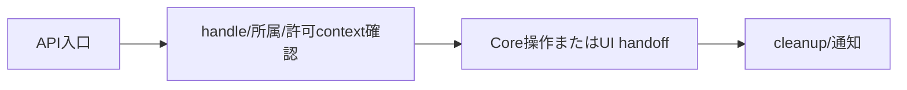

# SEP-S02 / MVVM UIライブラリ Runtime契約（Slice 1）の責務分離レビュー案

- 文書版: 0.2
- 状態: 全案反映承認済み・正本適用済み（2026-10-17）。具体化未了は適用結果を参照
- 作成日: 2026-10-17
- 対象: [元文書](../../12_design/runtime-contract.md)
- 対象箇所: Runtime契約 R1～R4、§2～8
- 索引: [一括レビュー](index.md)
- 台帳項目: S02

- 現行要求根拠: [RQ-02-013](../../11_requirements/RQ-02_core-features.md#rq-02-013)、[RQ-04-005](../../11_requirements/RQ-04_abi-boundary.md#rq-04-005)、[RQ-05-002](../../11_requirements/RQ-05_ownership-callbacks.md#rq-05-002)、[RQ-05-003](../../11_requirements/RQ-05_ownership-callbacks.md#rq-05-003)、[RQ-05-009](../../11_requirements/RQ-05_ownership-callbacks.md#rq-05-009)、[RQ-06-002](../../11_requirements/RQ-06_threading-dispatch.md#rq-06-002)

## 対象本文と既存承認

- 状態: R1～R4承認済み（2026-09-26）

作成時点の原文SHA-256: `e694ccf2e89219da4f9a142881293756d78e92f119de94003dbbf4a90d13b0f8`。対象は台帳の箇所と、以下の原文・判断ID。正本の本文は今回編集していない。

原文 R1 / L95:

> handleを非再利用の64-bit数値トークンにする

原文 R2 / L96:

> Runtime作成スレッドをUI threadとし、worker releaseのみ遅延破棄する

## 改訂判断案

| レビューID | 変更対象 | 提案 |
|---|---|---|
| SEP-S02-01 | 外部契約と要求の根拠 | [SEP-RQ-001 任意threadの参照取得・破棄](rq-candidates.md#candidate-001)、[SEP-RQ-002 破棄済み参照への重複破棄](rq-candidates.md#candidate-002)、[SEP-RQ-003 安全な参照を発行できない場合](rq-candidates.md#candidate-003)、[SEP-RQ-005 破棄失敗時の参照保全](rq-candidates.md#candidate-005)、[SEP-RQ-006 Runtime停止後の利用境界](rq-candidates.md#candidate-006)、[SEP-RQ-007 Runtime終了の再要求](rq-candidates.md#candidate-007)、[SEP-RQ-008 callback/event中の終了要求](rq-candidates.md#candidate-008)、[SEP-RQ-009 終了要求の受付と完了](rq-candidates.md#candidate-009)、[SEP-RQ-010 停止したUI loopへの同期要求](rq-candidates.md#candidate-010)、[SEP-RQ-025 判定callback中の禁止操作](rq-candidates.md#candidate-025)へ対応付ける。既存RQで定まる結果は上流参照にし、補足/選択要は要求承認後に設計前提へ反映する |
| SEP-S02-02 | 実現手段の本文 | 下記の責務・data/ownership flow・stateを本文案として収録する。個別の公開名・signatureを新たに確定する判断とは分ける |
| SEP-S02-03 | 未決・承認粒度 | R1～R4を方式のIDとして維持する。worker同期/非同期入口はRQ候補承認後に整合。§8試験列挙はtestへ。 |

## 設計本文の改訂案

RuntimeはUI実行thread identity、object所属と公開/内部参照、dispatch経路、closure寿命を統合する。worker releaseは最終UI破棄だけをUI経路へ引き渡す。callback種別で許可APIを検査し、通知は外側処理後に進める。R2の「shutdown呼出しはUI thread限定」をBD-36の要求受付とUI上のcleanup実行へ分けて書き直す。

## 移管・ID・検証への影響

- 既存ID: R1～R4。方式として残る意味は旧IDを維持し、要求へ分ける文だけを仮候補IDに対応付ける。正式RQ IDの発番は[移行案](id-migration.md)による。
- 移管先: 利用者可視条件は上記RQ候補、C/言語APIの具体形はDD内、脅威と防御はSD、試験操作と判定手順はrequirements-test/unit-test、着手順と下流割当はto-do。
- 設計を説明する所有・state・call図と計算例は保持する。対象本文の試験節は、[検証改訂案](test-impact.md)へ対応付けてから移す。失敗時の状態表・cleanup順まで検証扱いで削除しない。
- 上流RQ/ADR/BDへの参照は該当記述に直接置く。後続の着手割当は計画へ移し、DD間のinterface依存参照は実際の定義側へ向けて循環を解く。文書番号の大小だけで依存を判定しない。

## 承認履歴

| 日付 | 対象 | 承認者 | 結果 |
|---|---|---|---|
| 2026-10-17 | SEP-S02 | — | 一括作成指示に基づくレビュー案。採用・正本適用は未承認 |

## 改訂履歴

| 版 | 日付 | 内容 | 状態 |
|---|---|---|---|
| 0.1 | 2026-10-17 | 現行文書から責務分離・改訂文案・影響を作成 | レビュー待ち |

## 2026-10-17 適用結果

[適用先](../../12_design/runtime-contract.md) の版0.1へ反映した。補足要求は正式IDへ対応付け、未設計事項は [後続課題](../requirements-design-separation-follow-up.md) に移した。

### 承認履歴

| 日付 | 範囲 | 承認者 | 結果 |
| --- | --- | --- | --- |
| 2026-10-17 | 全レビュー案の反映 | 利用者 | 「すべて反映して下さい。」により採用・正本適用を承認 |

### 改訂履歴

| 版 | 日付 | 内容 |
| --- | --- | --- |
| 0.2 | 2026-10-17 | 承認と正本適用結果を追記。作成時点の比較・引用を保持 |
