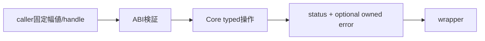

# SEP-S03 / MVVM UIライブラリ C ABI仕様案（Slice 1基盤・Slice 2 MVVM）の責務分離レビュー案

- 文書版: 0.2
- 状態: 全案反映承認済み・正本適用済み（2026-10-17）。具体化未了は適用結果を参照
- 作成日: 2026-10-17
- 対象: [元文書](../../12_design/abi-spec.md)
- 対象箇所: C ABI仕様 A1～A32、§2～22
- 索引: [一括レビュー](index.md)
- 台帳項目: S03

- 現行要求根拠: [RQ-02-002](../../11_requirements/RQ-02_core-features.md#rq-02-002)、[RQ-02-013](../../11_requirements/RQ-02_core-features.md#rq-02-013)、[RQ-04-002](../../11_requirements/RQ-04_abi-boundary.md#rq-04-002)、[RQ-04-003](../../11_requirements/RQ-04_abi-boundary.md#rq-04-003)、[RQ-04-006](../../11_requirements/RQ-04_abi-boundary.md#rq-04-006)、[RQ-04-007](../../11_requirements/RQ-04_abi-boundary.md#rq-04-007)、[RQ-04-009](../../11_requirements/RQ-04_abi-boundary.md#rq-04-009)、[RQ-04-010](../../11_requirements/RQ-04_abi-boundary.md#rq-04-010)、[RQ-05-002](../../11_requirements/RQ-05_ownership-callbacks.md#rq-05-002)、[RQ-05-003](../../11_requirements/RQ-05_ownership-callbacks.md#rq-05-003)、[RQ-05-004](../../11_requirements/RQ-05_ownership-callbacks.md#rq-05-004)、[RQ-05-006](../../11_requirements/RQ-05_ownership-callbacks.md#rq-05-006)、[RQ-05-009](../../11_requirements/RQ-05_ownership-callbacks.md#rq-05-009)、[RQ-06-004](../../11_requirements/RQ-06_threading-dispatch.md#rq-06-004)、[RQ-09-005](../../11_requirements/RQ-09_ui-scope.md#rq-09-005)

## 対象本文と既存承認

- 状態: A1～A32承認済み（2026-09-26）。A5の初期公開値型の範囲は承認済みBD-01で改訂。追加型の具体ABIは後続設計

作成時点の原文SHA-256: `0ea124fbef2955eb9a94648743225c6ca4c554a68a02199e1c31dab01b6f74eb`。対象は台帳の箇所と、以下の原文・判断ID。正本の本文は今回編集していない。

原文 A1 / L120:

> `ui_handle`を64-bitトークンとし、共通retain/releaseを使う

原文 A2 / L121:

> errorは返り値statusに加え、任意のout_error handleで返す

原文 A4 / L123:

> shutdownはUI threadで完了させ、未実行postのdestroyまで保証する

原文 A8 / L193:

> 値の種類違い・入力不正・Validation失敗・スレッド違反を区別し、setter成功と通知完了を分ける

## 改訂判断案

| レビューID | 変更対象 | 提案 |
|---|---|---|
| SEP-S03-01 | 外部契約と要求の根拠 | [SEP-RQ-004 参照の種類・所属の拒否結果](rq-candidates.md#candidate-004)、[SEP-RQ-006 Runtime停止後の利用境界](rq-candidates.md#candidate-006)、[SEP-RQ-011 ABI F32要求の未対応範囲](rq-candidates.md#candidate-011)、[SEP-RQ-015 UTF-8文字列の受渡し結果](rq-candidates.md#candidate-015)、[SEP-RQ-016 buffer不足時の結果](rq-candidates.md#candidate-016)、[SEP-RQ-017 error詳細を生成できない失敗](rq-candidates.md#candidate-017)、[SEP-RQ-019 機能照会と互換性](rq-candidates.md#candidate-019)、[SEP-RQ-024 Validator登録条件](rq-candidates.md#candidate-024)、[SEP-RQ-025 判定callback中の禁止操作](rq-candidates.md#candidate-025)、[SEP-RQ-026 TextBox入力三値の結果](rq-candidates.md#candidate-026)、[SEP-RQ-030 外部更新と編集中の値](rq-candidates.md#candidate-030)、[SEP-RQ-031 Command実行受付と結果](rq-candidates.md#candidate-031)、[SEP-RQ-032 取消・close・handle破棄の差](rq-candidates.md#candidate-032)へ対応付ける。既存RQで定まる結果は上流参照にし、補足/選択要は要求承認後に設計前提へ反映する |
| SEP-S03-02 | 実現手段の本文 | 下記の責務・data/ownership flow・stateを本文案として収録する。個別の公開名・signatureを新たに確定する判断とは分ける |
| SEP-S03-03 | 未決・承認粒度 | A7は予約のままで生成APIを公開しない。A11/A14/A19のrelease非解除は承認済みRQに合わせ、X01改訂待ちを個別に管理する。 |

## 設計本文の改訂案

ABI章を、言語非依存境界とstatus/error/所有の主要flowを説明する基本設計と、C宣言・型幅・symbol・enum・出力初期値を具体化するDD内ABI分冊へ分ける。A1～A32は旧IDとして由来を保持し、外部結果はRQ候補、所有handoffは設計に対応付ける。C宣言の移管では既存signatureを黙って変更しない。

## 移管・ID・検証への影響

- 既存ID: A1～A32（A5改訂とA7予約を含む）。方式として残る意味は旧IDを維持し、要求へ分ける文だけを仮候補IDに対応付ける。正式RQ IDの発番は[移行案](id-migration.md)による。
- 移管先: 宣言の正本候補はDD内ABI分冊。元abi-spec.mdには境界・所有flow・旧A ID対応を残す。
- 設計を説明する所有・state・call図と計算例は保持する。対象本文の試験節は、[検証改訂案](test-impact.md)へ対応付けてから移す。失敗時の状態表・cleanup順まで検証扱いで削除しない。
- 上流RQ/ADR/BDへの参照は該当記述に直接置く。後続の着手割当は計画へ移し、DD間のinterface依存参照は実際の定義側へ向けて循環を解く。文書番号の大小だけで依存を判定しない。

## 承認履歴

| 日付 | 対象 | 承認者 | 結果 |
|---|---|---|---|
| 2026-10-17 | SEP-S03 | — | 一括作成指示に基づくレビュー案。採用・正本適用は未承認 |

## 改訂履歴

| 版 | 日付 | 内容 | 状態 |
|---|---|---|---|
| 0.1 | 2026-10-17 | 現行文書から責務分離・改訂文案・影響を作成 | レビュー待ち |

## 2026-10-17 適用結果

[適用先](../../12_design/abi-spec.md) の版0.3へ反映した。補足要求は正式IDへ対応付け、未設計事項は [後続課題](../requirements-design-separation-follow-up.md) に移した。

### 承認履歴

| 日付 | 範囲 | 承認者 | 結果 |
| --- | --- | --- | --- |
| 2026-10-17 | 全レビュー案の反映 | 利用者 | 「すべて反映して下さい。」により採用・正本適用を承認 |

### 改訂履歴

| 版 | 日付 | 内容 |
| --- | --- | --- |
| 0.2 | 2026-10-17 | 承認と正本適用結果を追記。作成時点の比較・引用を保持 |
