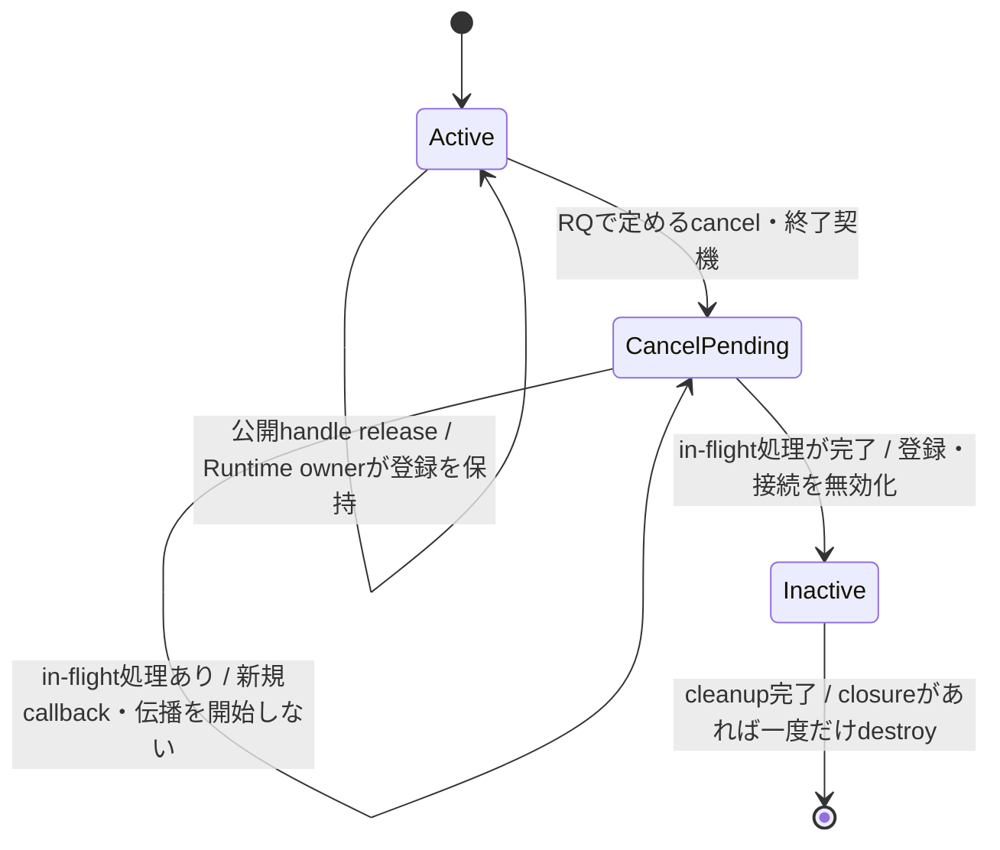

# SEP-01 / X01: releaseと明示解除の責務分離

- 文書版: 0.3
- 状態: 全案反映承認済み・責務分離の正本適用完了（2026-10-17）。未設計課題は別計画へ移管
- 作成日: 2026-10-12
- 対象: 最後の公開handle releaseとSubscription / Binding / Validator登録の解除
- 親計画: [要求・基本設計・詳細設計の責務分離とID整理計画](requirements-design-separation.md)
- 調査項目: [X01](requirements-design-separation-inventory.md)

## 現在の適用結果

[全案適用結果](requirements-design-separation-application-result.md)と[未設計の後続課題](requirements-design-separation-follow-up.md)を参照する。以下の走査・案作成時点の差異や未承認表示は当時の記録であり、現在の承認状態は本節と承認台帳を正本とする。

## 1. 目的と判断境界

承認済みRQ、C ABI判断、DD判断の間で、公開handleの最後の`release`が登録を解除するかどうかに差がある。どの記述を要求・設計へ置くか、既存承認をどう整合させるかをレビューする。ここでは実装方式や新しい解除APIを決めない。

## 2. 根拠の比較

| 根拠 | 状態 | 現在の記述 | ロール上の分類 |
|---|---|---|---|
| [RQ-05-002](../11_requirements/RQ-05_ownership-callbacks.md#rq-05-002) | RQ-05 v0.3承認済み | `release`は呼出側の所有参照を一つ消費する。複数参照を独立して解放する | RQ。handle所有参照の一般規則。registration cancelとの関係は明記していない |
| [RQ-05-006](../11_requirements/RQ-05_ownership-callbacks.md#rq-05-006) | RQ-05 v0.3承認済み | callback closureの保持側と、明示解除・所有対象破棄・Runtime終了時の無効化をAPIごとに定める | RQ。callback寿命の外部契約を要求するが、各APIの具体契機は設計に委ねる |
| [RQ-07-011](../11_requirements/RQ-07_binding.md#rq-07-011) | RQ-07 v0.3承認済み | Bindingの明示解除後は将来・保留中の伝播を止め、値を維持する | RQ。明示解除の結果を規定し、handle release時の動作は述べていない |
| [A11 / ABI §10](../12_design/abi-spec.md) | ABI判断A1～A32承認済み、2026-09-26 | Subscriptionは明示解除し、handleの`release`だけでは解除しない | 承認済みC ABI設計判断。利用者から見えるAPI契約 |
| [A14 / ABI §12](../12_design/abi-spec.md) | ABI判断A1～A32承認済み、2026-09-26 | Binding handleの`release`では解除せず、明示解除またはshutdownまでRuntimeが保持する | 承認済みC ABI設計判断。利用者から見えるAPI契約 |
| [A19 / ABI §14](../12_design/abi-spec.md) | ABI判断A1～A32承認済み、2026-09-26 | 明示解除・Property破棄・shutdownでclosureを一度破棄し、handleの`release`だけでは解除しない | 承認済みC ABI設計判断。callback登録の外部契約 |
| [DD-LIFE-04～05](../13_detail_design/02-runtime-lifetime.md) | DD-02内容承認済み、2026-09-29 | Subscription / Bindingの最後の公開参照releaseでも自動解除する | 承認済み詳細設計。A11/A14と衝突 |
| [DD-PROP-08](../13_detail_design/07-property-notification.md) | DD-07承認済み、2026-10-08 | Subscription handleのreleaseだけではcancelしない。Property破棄・shutdownでは無効化する | 承認済み詳細設計。A11と整合し、DD-LIFE-04と衝突 |
| [DD-VALID-06](../13_detail_design/09-validation-input.md) | DD-09承認済み、2026-10-11 | Validatorは明示cancelをhandle releaseと区別し、Property破棄・shutdownでも後始末する | 承認済み詳細設計。A19と整合する範囲を持つ |

## 3. 差異の判定

1. RQ-05-002の「参照を一つ消費」と、RQ-05-006の「callback解除契機をAPIごとに定める」は、registrationが公開参照とは別に生存し続ける可能性を排除していない。したがって現行RQだけでは、releaseが暗黙cancelかどうかを決められない。
2. A11/A14/A19はreleaseと明示cancelを区別する。DD-PROP-08およびDD-VALID-06にも同じ区別がある。
3. DD-LIFE-04/05の最終公開参照releaseによる自動解除はA11/A14と直接両立しない。DD-02が内容承認済みでも、下位DDだけを黙って優先または改訂できない。`RQ-16-004`の不整合処理に従い、変更対象と影響を明示して承認を得る必要がある。
4. releaseとcancelの差、最後の公開handleを解放しても動作が続く条件、callback/Bindingの解除契機は利用者から観測できる契約であり、RQに置く。既承認A11/A14/A19をその契約根拠として保持し、DDに要求例外を定義させない。DDは承認された各契機の後に内部状態・参照・cleanupをどう遷移させるかを具体化する。

## 4. 提案する分離と改訂

本節の分離方針は2026-10-12に利用者承認済みであり、対象のRQ・ABI・DD正本へ改訂案を反映した。個々の文書本文は承認前のレビュー案として扱う。要求上の外部動作はRQ、設計側はその契約を実現する内部構造・処理フローを記載する。

### 要求側の候補

- RQ-05-002の要求・受入確認に、registration handleの`release`は呼出側の公開所有参照を一つ消費するだけで、registrationのcancelを代替しないことを明記する（A11/A14/A19の承認済み契約をRQへ移す）。
- RQ-05-006のcallback解除契機と外部から見える完了結果を明記する。A19の承認済み契約では明示cancel、対象Propertyの破棄、Runtime終了で無効化し、closureを一度破棄する。
- RQ-07-011に、Binding handleのreleaseは明示解除ではなく、明示解除後は保留中の伝播も含め止まるというA14の契約を記す。既存IDで不足する場合だけ新規IDを提案する。

### 設計側の候補

設計側では解除契機を追加・変更せず、RQで承認された入力条件をどう実現するかを記す。例えばDD-02/04/07/08/09では、handle参照とregistration ownerの関係、Runtime/Property/Binding/Subscription/Validator各層の責務、callback・保留伝播のデータフロー、cleanup順序、in-flight処理の扱いを具体化する。

以下はA11/A14/A19の既承認契約に沿った内部状態遷移のレビュー骨子であり、DD改訂そのものではない。

DDの本設計ではSubscription、Binding、Validatorそれぞれについて、同じ状態名を機械的に流用せず、該当する状態・遷移条件・所有参照・保留workの破棄位置を定義する。BDでは各層の責務と大きな流れを示し、DDでは型・interface、呼出し順・競合処理まで具体化する。
## 5. 影響範囲

| 対象 | 想定する変更 |
|---|---|
| RQ-05 v0.3 | RQ-05-002/006の要求と受入確認を改訂。要求版の承認を別途受ける |
| RQ-07 v0.3 | RQ-07-011にreleaseとcancelの区別を置く必要性を決める。重複があればRQ-05の共通要求を参照 |
| ABI仕様 | A11/A14/A19は意味変更候補にしない。文書ロールを整理した旨を履歴に記録する |
| DD-02 | DD-LIFE-04/05の明示解除・最終公開release・内部参照契約を改訂する候補。DD-02承認の訂正/改訂を明示して再承認する |
| DD-07/08/09 | DD-PROP-08、DD-BIND-04等、DD-VALID-06との参照整合を点検。A11/A14/A19に合う記述は維持 |
| 要求test | 解除前後、唯一の公開handle release後、Property破棄、shutdown、保留callback/伝播を別caseとして対応表へ紐づける。要求承認後に更新 |
| unit-test | Runtime registry ownership、弱参照index、cleanup競合は実装単位の内部検証として設計する |

## 6. 改訂案のレビュー範囲

X01の分離方針は承認済みである。今回のレビュー対象は、正本文書に反映した次の具体的な文面・設計詳細と、承認状態の記録である。

1. [RQ-05](../11_requirements/RQ-05_ownership-callbacks.md): RQ-05 v0.7のレビュー案。全IDを「利用者が判断・実行できること」または「外から保証される結果」で記述し、API契約の書き方、wrapperの保持/複製、callback stack、post処理など実現手段を要求本文から除く。RQ-05-002の取得・破棄の独立性と登録継続、RQ-05-003の参照寿命、RQ-05-006～008のcallback/userdataの外部寿命保証は別の契約として維持する。
2. [RQ-07](../11_requirements/RQ-07_binding.md): RQ-07-009/010の境界整理とRQ-07-011のrelease/cancel契約を含むv0.5を承認済み。要求test対応は[対応表](../30_release_test/requirement-test-matrix.md)へ反映済み。
3. [DD-02](../13_detail_design/02-runtime-lifetime.md): DD-LIFE-03～05のregistration owner、参照方向、状態遷移、in-flight処理、cleanup順を記載したv0.3改訂案。RQ-05 v0.8/RQ-07 v0.5に対応付け、レビュー待ち。
4. [DD-07](../13_detail_design/07-property-notification.md)、[DD-08](../13_detail_design/08-binding-graph.md)、[DD-09](../13_detail_design/09-validation-input.md): DD-02承認後、subscription・Binding・Validatorのactive owner、token release、解除・teardown・shutdown時の状態/cleanup順を整合させたv0.3改訂案。各文書の該当判断はレビュー待ち。
5. [ABI仕様](../12_design/abi-spec.md): A11/A14/A19の既承認意味を保ち、外部契約の正本をRQへ対応づけた改訂。

設計側の候補移管先は、参照とregistration ownerの関係・cleanup遷移をDD-02、callback実行中/解除と再入抑止の処理順をDD-03/04、文字列・pointerの境界とborrow契約をDD-05/06および言語wrapperのDD-18～21、Property購読・Binding・Validator固有の登録寿命をDD-07/08/09とする。既存DDの承認済み判断との衝突は別途差分として示し、RQ草案だけでDDの承認範囲を変更しない。RQ本文から受入確認・検証手順を分離し、[requirements-test対応表](../30_release_test/requirement-test-matrix.md)側の既存論理caseへ要求IDごとの判定内容を割り当てた。RQ-05 v0.8と、対応表v0.5のRQ-05-001～009をTC-LIFE-01/TC-OWN-01/TC-CALLBACK-01へ割り当てた範囲は2026-10-13承認済み。ABI/DD改訂案および対応表の他範囲は引き続きレビュー待ちであり、X01全体の対応確認後に次の論点へ進む。

## 7. 承認履歴

| 日付 | 対象 | 承認者 | 結果・根拠 |
|---|---|---|---|
| 2026-10-12 | SEP-01 / X01の要求文改訂・release/cancel契約・DD内部実現方針 | 利用者 | 案を承認。要求・DD・ABIの各正本へ改訂を反映するよう指示 |
| 2026-10-13 | RQ-07 v0.5 | 利用者 | RQ-07-009/010分離を含む要求案を承認。要求test対応を反映 |
| 2026-10-13 | RQ-05 v0.8、requirements-test v0.5のRQ-05-001～009対応範囲 | 利用者 | 要求改訂とTC-LIFE/OWN/CALLBACKへの対応を承認。ABI/DD改訂案と対応表の他範囲は対象外 |
| 2026-10-13 | DD-02 v0.3 / DD-LIFE-03～05 | 利用者 | 公開token releaseと登録解除の内部sequence、参照更新、cleanup flowを承認 |

## 8. 改訂履歴

| 版 | 日付 | 変更内容・理由 | 作成者 | 承認履歴への対応 |
|---|---|---|---|---|
| 0.1 | 2026-10-12 | RQ・ABI・DDの解除契約を照合し、責務分離と改訂候補を提示 | Codex | 利用者レビュー待ち。仕様変更なし |
| 0.2 | 2026-10-12 | 外部動作・例外をRQ、内部状態・flow・ownershipをBD/DDに分類し、設計遷移のレビュー骨子を追加 | Codex | 今回の役割境界指示に対応 |
| 0.3 | 2026-10-12 | 利用者承認を記録。RQ-05/07、ABI、DD-02/07/08/09の改訂案を対応させる | Codex | 方針承認済み。各正本文書の改訂案はレビュー待ち |
| 0.4 | 2026-10-13 | RQ-07 v0.5の承認状態と要求test対応を反映 | Codex | RQ-07は承認済み。RQ-05およびABI/DD改訂はレビュー待ち |
| 0.5 | 2026-10-13 | RQ-05 v0.7を利用者の能力・外部保証中心に改訂し、設計候補の移管先をDD-02～09およびDD-18～21へ対応付け | Codex | 利用者の着手指示を反映。RQ-05 v0.7および設計改訂はレビュー待ち |
| 0.6 | 2026-10-13 | RQ本文の受入確認をrequirements-test対応表へ分離し、RQ-05 IDごとに論理caseの判定内容を記載 | Codex | 利用者指摘を反映。RQ-05 v0.8・対応表改訂案はレビュー待ち |
| 0.7 | 2026-10-13 | RQ-05 v0.8とrequirements-test v0.5のRQ-05対応範囲の承認を記録 | Codex | 利用者承認を反映。ABI/DD改訂案と対応表の他範囲はレビュー待ち |
| 0.8 | 2026-10-13 | DD-02の公開token releaseとregistration解除のsequence/dataflowをレビュー対象に追加 | Codex | DD-02 v0.3改訂案はレビュー待ち |
| 0.9 | 2026-10-13 | DD-02 v0.3の利用者承認を記録し、DD-07/08/09の登録owner・処理flow整合へ進む | Codex | DD-02承認済み。DD-07/08/09は個別改訂・承認待ち |
| 1.0 | 2026-10-13 | DD-02の承認済みowner/cleanup flowに合わせてDD-07/08/09のX01改訂案を整合 | Codex | DD-07/08/09 v0.3レビュー待ち。ABI改訂とtest対応表の他範囲は未承認 |

## 2026-10-17 適用結果

全66台帳項目の分離を適用した。D23は要求testへの既存移管を維持し、廃止文書を再作成していない。

### 承認履歴

| 日付 | 範囲 | 承認者 | 結果 |
| --- | --- | --- | --- |
| 2026-10-17 | 全レビュー案の反映 | 利用者 | 「すべて反映して下さい。」により採用・正本適用を承認 |

### 改訂履歴

| 版 | 日付 | 内容 |
| --- | --- | --- |
| 0.3 | 2026-10-17 | 承認と正本適用結果を追記。作成時点の比較・引用を保持 |
