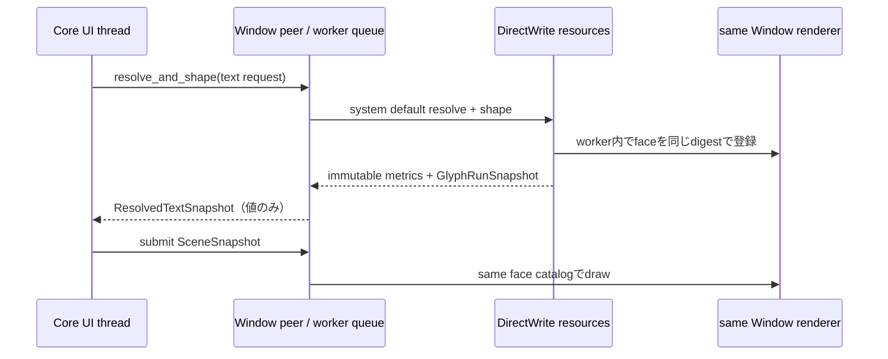

# 0.0.1 Windows TextService・Scene・Window renderer 縦断接続計画

- 計画版: 0.3
- 状態: Window単位TextService方式を利用者承認済み。DD 2.1/UI DD 1.5/unit-test設計1.5を更新済み。Core/Windows Platform units実装・local gates・同revision Windows/Ubuntu CI完了。merge PR待ち
- 対象: Core Controlのtext snapshotからWindows system default fontのGlyphRunを生成し、同じfont faceでWindowへ描画する内部接続
- 前提branch: `impl-rust/core-scene-producer`
- Core APIs branch: `impl-rust/core-window-text-service`（親branch）
- Windows Platform子branch: `impl-rust/platform-adapter-windows-text-scene`（現在のbranch）

## 目的

Windows profileで、Text/TextBox/Button labelの表示用textがCoreの既存Layout・Scene生成を通り、Windows DirectWrite rendererで実際に描画できる接続を完成させる。公開C ABI・言語wrapperは変更しない。

本計画は新しい要求や設計を確定しない。DirectWrite/COM objectのthread affinity、TextServiceの共有方法、font faceの登録先について承認済みDDとの不整合が判明した場合は、その部分の実装を止め、必要なDD差分をレビューに出す。

## 現状

- Coreの`TextService` seam、Text/TextBox/Buttonからのtext snapshot取得、同一revisionのresolved textをLayoutとVisual Sceneで共有する経路は実装済み（`UNIT-CORE-084/085/086/087`）。
- Windows DirectWrite TextServiceとfont catalogの接続部品は実装済み（`UNIT-PLATFORM-WINDOWS-004`）。
- Windows Platform factoryはRuntimeへWindows `TextService`を提供していない。したがってWindows RuntimeではCoreのtext resolveが実際のDirectWrite実装へ届かない。
- DirectWriteでshapeしたGlyphRunのfaceとWindow rendererのfont catalogを同一owner/lifecycleで使うcall flowが未接続である。未登録digestはframe failureになる。
- 以上のため、既存のCore production SceneとWindows rendererは個別に存在するが、Windows上でControl textを描画する縦断経路はまだない。

## 事前確認で見つかった設計境界

現行実装ではCore `RuntimeCore`がfactoryから単一の`TextService`を取得して保持し、Layout準備時にRuntimeのUI threadから同期呼出しする。一方、WindowsはWindowごとにworkerを持ち、DirectWrite `FontResources`とrendererをそのworker上で生成・操作・破棄する。既存`FontResources::shape_text`にもcallerとresource ownerは同じWindows workerであるという前提がある。

従って、factory-level `TextService`からUI thread上でDirectWriteを呼び、後でfaceをWindow workerへ渡す案は採用できない。既存設計にないCOM objectのthread間共有/marshalingも追加しない。

### 承認済み実現方式

Platform内部設計ではWindows TextServiceをWindow peerに対応したsessionとして扱う。Linux等は既存のRuntime共通serviceを維持する。

- CoreのWindowごとに、そのWindow peerと同じworkerへ同期requestを送るTextService handleを関連付ける。
- DirectWrite objectはworker内に留め、Coreへはmetrics・glyph value・digestのみ返す。face登録、shape、render、resource releaseは同じWindow workerで実施する。
- TextService呼出しに利用者callbackやCore再入を発生させない。worker停止・Window close時は未処理requestをfailureで完了し、shutdown時にresourceをworker owner上で解放する。
- これはCore private SPIとDDの追加具体化であり、公開C ABI/APIや要求上の保証を追加しない。UI threadからworkerへの同期待機・close競合・複数Window時のservice関連付けを明示する。

この方式は2026-11-01に利用者承認済み。詳細設計・unit-test設計へ反映した上で実装する。

## 上位根拠・承認境界

- 要求: [RQ-09-053](../11_requirements/RQ-09_ui-scope.md#rq-09-053)（Latin・日本語textとfont条件）、[RQ-09-054](../11_requirements/RQ-09_ui-scope.md#rq-09-054)（初期対象外の文字）、[RQ-09-072](../11_requirements/RQ-09_ui-scope.md#rq-09-072)（単一paragraph・client clip・黒色既定等）、[RQ-09-075](../11_requirements/RQ-09_ui-scope.md#rq-09-075)（Platform system default font）、[RQ-11-023](../11_requirements/RQ-11_platform.md#rq-11-023)（profile別font/文字対応）。
- ADR: [ADR-0001](../04_approval/adr-0001-rust-core.md)。Rust Coreを動作の正本とし、Platform adapterを交換可能にする。
- 基本設計: [プラットフォーム抽象化](../12_design/platform/abstraction.md)。TextServiceとPlatform font解決の責務境界。
- 詳細設計: [プラットフォーム内部レイヤー](../13_detail_design/platform/internal-layers.md) 2.1、[UIクラス](../13_detail_design/ui/controls.md) 1.5。TextService結果をMeasureとSceneで共有し、Windowsでは同一workerがDirectWrite faceをshape/renderする。
- 試験: [UI単体試験](../32_unit_test/ui.md) 1.4、[unit-test strategy](../32_unit_test/unit-test-strategy.md)、[implementation-test inventory](../32_unit_test/implementation-test-inventory.md)、[変更検証command](../../DEVELOPMENT.md)。

## 対象範囲

1. Coreが各Window peerへTextServiceを関連付け、Text/TextBox/Button labelの`PlatformDefault` requestをそのWindowのserviceへ送る。Linux等は既存のRuntime共通serviceを維持する。
2. TextServiceのresolved metrics・glyph runsを、Coreの既存same-revision Layout/Scene経路で使う。
3. DirectWriteでglyphを作ったfont faceをWindows rendererが同じdigestで解決する。複数face fallbackのrun分割、shape/face登録失敗、digest不一致を成功frameにしない。
4. COM/native resourceを承認済みDDのowner/thread/lifecycleへ沿って保持・解放する。正常closeと途中失敗の双方で漏れ・二重解放を避ける。
5. Windows固有のfactory・worker・renderer境界をfake可能な内部試験で検証する。既存のCore fake TextService試験とDirectWrite resolver試験を置き換えず、接続境界の証拠を追加する。

System default fontを使い、family名・固定Fonts path・OS別pixel出力を固定しない。RQ-09-054の対象外文字、TextBox編集/IME、Accessibility、公開font APIは追加しない。

## 実装単位・試験案

| Unit | 責務 | 対応試験案・完了条件 |
|---|---|---|
| `UNIT-CORE-089`（planned） | Runtime-wide fallbackに加えてWindow peer-bound TextService endpointをCore private SPIへ追加し、WindowLifecycleへserviceを関連付ける。Layout text resolveは対象Windowのserviceを優先し、なければRuntime共通serviceを使う。公開C ABIは変更しない | 新規`UT-CORE-WINDOW-TEXT-001`で、per-window service選択・Window間分離・Runtime fallback・service欠落/失敗時のpartial Layout拒否をfake peer/serviceで検証する。Core focused/all tests、workspace check、Clippy、Rust minimum、formatが同一revisionで成功 |
| `UNIT-PLATFORM-WINDOWS-005` | Windows peerから同じWindow workerへdispatchするTextServiceを実装する。workerがDirectWrite resolve/shapeと同一renderer catalogへのface登録を行い、Coreにはimmutable snapshotだけ返す。COM objectをworker外へ出さない | `UT-PLATFORM-WINDOWS-TEXT-FLOW-001`でfake peer backend/worker resolverのrevision・close・failureを検証し、既存DirectWrite catalog/render testsと合わせてface identity経路を確認する。Windows/Workspace gatesとRust 1.85 minimum checkが同一revisionで成功 |

実装着手時にunit/test名とpath衝突を再確認し、`.docs/32_unit_test/implementation-test-inventory.md`、`tools/units.yaml`、必要なunit-test設計へ登録する。接続試験は特定Windows family名・実画面pixelをoracleにしない。公開仕様の要求testやWindows GUI実機smokeの代替にはしない。

### 試験観測候補

- Windows factoryから取得したTextServiceがCoreのtext requestを解決し、Text/TextBox/Button labelのSceneにglyph dataとface identityを届ける。
- property更新後に新しいtext revisionが再解決され、LayoutとSceneがそのrevisionの同一resolved snapshotを参照する。
- shapeで使用したface digestが当該Window rendererのcatalogで解決できる。異なる/未登録digest、解決不能font、DirectWrite描画failureをPresented成功として記録しない。
- text resolveまたはface登録が失敗した場合、Coreの既存failure atomicity・dirty retry契約を保ち、部分的なLayout/Sceneを公開しない。
- Window closeおよび生成途中のerror pathでface/file/cache resourceが一度だけ解放される。
- Windows GUIの可視表示・実OS font選択・日本語の品質はCI unit条件にしない。

## 進行段階

### 1. 所有・thread境界を照合

- `PlatformRuntimeFactory::text_service()`の寿命、Windows workerのCOM apartment、`TextService: Send + Sync`境界、DirectWrite resolverとWindow rendererのcatalog lifetimeを実コードと承認済みDDで照合する。
- RuntimeのTextService呼出し元threadからWindows renderer ownerへface identity/resourceを渡す経路とclose順を図示し、既承認のowner契約内で閉じる方法を特定する。
- cross-threadでのCOM object共有や新しいCOM marshaling方式を、実装上の都合だけで決めない。承認済みDDでは成立しない場合、unit実装へ進まずDD変更案を提出する。

### 2. 接続境界の試験設計

- Core existing fake-service test、Windows DirectWrite resolver test、Windows frame renderer testで既に覆われる条件と新規接続条件を分離する。
- Windows factory→Core request→resolved snapshot→Scene→同じWindow rendererという接続・失敗・lifecycleの観測をtestへ具体化し、inventory/`tools/units.yaml`へ登録する。

### 3. 縦断接続

- Windows factoryへTextServiceを接続し、各Text resolve時の実際のface identityを対応Window rendererが安全に解決できるowner境界を実装する。
- DirectWrite face解決、shape、Scene submit、render/presentの失敗を既存のCore/Platform failure伝達に沿って伝える。
- 必要な変更が既承認DDを越えると分かった場合は、その範囲を分離して実装を停止する。

### 4. 同一revision検証とGit記録

- 対応focused tests、Windows target gate、workspace checks、Rust 1.85 minimum check、document/link checkを実行する。
- `.docs/32_unit_test/implementation-test-inventory.md`と`tools/units.yaml`へcommand、対象SHA、結果、CI evidenceを記録する。
- unitの試験合格後、日本語commit・pushする。関連TODOの完了後にまとめてmerge PRを作る。

## branch・作業管理案

- 現在`impl-rust/core-window-text-service` branch上で`UNIT-CORE-089`を実装する。Core unit完了後、これを親として`impl-rust/platform-adapter-windows-text-scene`を切り、`UNIT-PLATFORM-WINDOWS-005`を実装する。
- 公開C ABI・wrapper変更は引き続き対象外。各unitの対応test完了後に日本語commit・pushし、関連TODO完了後にまとめてmerge PRを作る。

## 対象外・別残課題

- Windows GUI実機でのvisible text・profile font・日本語表示品質の最終確認（本unit完了後の0.0.1 release qualification）。
- OS `WM_CLOSE`からCore close-requestへの連携（既存0.0.1残課題）。
- Linux DRM実機表示の確認。
- IME/TSF、text editing、Accessibility provider、Style/Theme、public font API、C ABI/wrapper。
- 要求の変更、family名の固定、OS Fonts directoryの独自走査、描画時の暗黙font fallback。

## 関連記録

- 先行実装計画: [Windows DirectWrite TextService接続](windows-text-service-directwrite-integration.md)
- 先行実装計画: [Windows Platform adapter](windows-platform-adapter.md)
- Core Scene実装記録: [implementation-test inventory](../32_unit_test/implementation-test-inventory.md)
- リリース全体: [0.0.1 release plan](release-0.0.1.md)

## 承認済み前提

1. Windows TextServiceはWindow worker内でresolve・shape・face登録し、COM objectをworker外へ渡さない。
2. CoreのControl→Layout→Scene経路は既実装。新しいCore unitはWindowごとのTextService選択だけを追加する。
3. Windows worker接続のfake testとWindows GUI profile smokeは分け、GUI確認は0.0.1 release qualificationに残す。

## 承認・改訂履歴

| 日付 | 対象版 | 承認者 | 結果 |
|---|---|---|---|
| 2026-11-01 | 計画0.1 | 利用者 | 承認。「OK」により計画に沿った作業開始を承認。実装・試験合格は別管理 |
| 2026-11-01 | 計画0.2 / owner・thread境界 | 利用者 | Window単位TextService方式を承認。Core UI threadからworkerへvalue requestを送り、DirectWrite resourceはworker内に留める |
| 2026-11-01 | 計画0.3 / 実装unit分割 | 利用者 | DD 2.1、UI DD 1.5、unit-test設計1.4へ反映。Core API parentからWindows Platform childへ分けて進行 |

## 実装・検証状況

- `UNIT-CORE-089`は実装済み。`UT-CORE-WINDOW-TEXT-001`、Core 184 tests、workspace all-targets tests、workspace Clippy、Rust 1.85 check、format、document linksがlocal pass。同revision Windows/Ubuntu CI pass: [run 41282511130](https://github.com/edamame-edame/freemvvm/actions/runs/41282511130)。
- `UNIT-PLATFORM-WINDOWS-005`はWindow peer TextService、Win32 worker queue command、DirectWrite metrics/face identity生成、同じrenderer catalogへのface保持を実装済み。focused 2 tests、Windows Platform 17 passed/2 ignored、workspace all-targets tests、workspace Clippy、Rust 1.85 check、format、document linksがlocal pass。同revision Windows/Ubuntu CI pass: [run 41282934478](https://github.com/edamame-edame/freemvvm/actions/runs/41282934478)。
- Windows GUI profile smokeは本unitのCI pass条件外で、0.0.1 release qualificationに残す。

