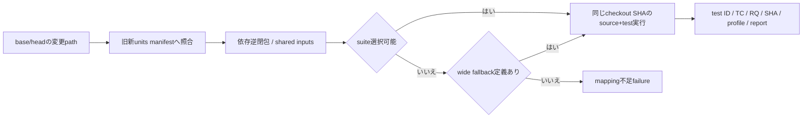

# UT-INVENTORY: 実装unit台帳・test ID・CI・scenario

- 文書版: 2.0（レビュー案）
- 状態: 1.1まで設計承認済み・正本適用済み（2026-10-17）。Windows Adapter unitsとclose-request unitsの試験設計は承認済み（2026-11-01）。UNIT-CORE-089、UNIT-PLATFORM-WINDOWS-005、UNIT-CORE-090、UNIT-PLATFORM-WINDOWS-006はlocal検証・同revision CI pass。Input/Focus実装unit 7件の登録案は全文レビュー待ち
- 文書種別: unit-test設計・契約
- 根拠RQ: [RQ-14-002](../11_requirements/RQ-14_delivery-sequence.md#rq-14-002)、[RQ-14-005](../11_requirements/RQ-14_delivery-sequence.md#rq-14-005)、[RQ-14-011](../11_requirements/RQ-14_delivery-sequence.md#rq-14-011)、[RQ-13-001](../11_requirements/RQ-13_nonfunctional-measurement.md#rq-13-001)、[RQ-13-011](../11_requirements/RQ-13_nonfunctional-measurement.md#rq-13-011)、[RQ-16-003](../11_requirements/RQ-16_document-governance.md#rq-16-003)
- 基本設計: [ビルド環境：toolchain・検証・support](../12_design/build/toolchain-support.md)

本書は承認された具体化の正本である。宣言・型・command・planned pathは設計情報で、配布済みヘッダ・実装済みAPI・試験合格の証拠ではない。将来候補・optional featureは本文で区別し、初期必須へ読み替えない。

## 実現判断

| 設計ID | 実現手段・責務 | 要求根拠 |
| --- | --- | --- |
| <a id="ut-inv-01"></a>UT-INV-01 | 単位IDはUNIT-<domain>-NNN、実testはUT-/REQT-/ABI-/WRAP-/INT-/SYS-/PLAT-/PKG-/REL-/VER-を境界に合わせる。論理TCと別fieldにする。 | 上記の根拠RQ |
| <a id="ut-inv-02"></a>UT-INV-02 | units.yamlにsource/config/generated inputs、depends_on、test command、RQ/DD/SD、logical casesを記録。未作成pathはplanned状態で実行対象と区別する。 | 上記の根拠RQ |
| <a id="ut-inv-03"></a>UT-INV-03 | source変更から依存逆閉包を選択。renameは旧新path、deletionは旧manifestのmapping、shared/config/header変更は該当全suite。 | 上記の根拠RQ |
| <a id="ut-inv-04"></a>UT-INV-04 | pushとpull_requestのchecked-out SHAを同じsource/testへ使う。PR merge commitを試す場合はmerge SHAとhead/base SHAをすべて証跡に記す。 | 上記の根拠RQ |
| <a id="ut-inv-05"></a>UT-INV-05 | Rust cargo test、C/C++ CTest、C# dotnet test、Python pytestを採用。fake host/clock/allocator/OS boundaryで異常注入する。 | 上記の根拠RQ |
| <a id="ut-inv-06"></a>UT-INV-06 | laneはfast-unit、ABI/4wrapper、platform/package、board/releaseに分ける。required checkはselectionと対象fast/ABI結果、releaseは全必須profile。 | 上記の根拠RQ |
| <a id="ut-inv-07"></a>UT-INV-07 | changed mapping、unit/test inventory、実行reportを別schemaで保存。reportにSHA/profile/command/toolchain/artifact digestとassertion結果を持つ。 | 上記の根拠RQ |
| <a id="ut-inv-08"></a>UT-INV-08 | 性能代表入力は計画文書にだけ置く。例として1k/10k items、128/129 delivery items、ASCII/日本語混在を用途付きで記録し、製品上限・合格閾値にしない。 | 上記の根拠RQ |
| <a id="ut-inv-09"></a>UT-INV-09 | CI actionsはfull commit SHA、pull_request_targetでuntrusted codeを実行しない。self-hosted boardは承認済みsourceのみ別queueで実行する。 | 上記の根拠RQ |

## 実現設計

### 開発基盤の現行登録

[tools/units.yaml](../../tools/units.yaml)にschema2のUNIT-BUILD-001を登録した。YAMLのJSON互換記法を使い、開発コマンド・設定・probeと、[bootstrap検証](development-bootstrap.md)の実入口を対応付ける。readyはbootstrapの実在source/commandと実行確認に限り、下記planned例の製品UNIT-CORE-001やUT-CORE-HANDLE-001をreadyへ昇格しない。CIの現状は全bootstrap gateの常時実行で、製品unitのpath選択器は未実装である。

| `UNIT-CORE-084` | Core-neutral `PlatformDefault` requestとresolved font identity/metrics snapshot。revision mismatchおよびTextService failureの部分結果拒否をfake serviceで確認 | `UT-TEXT-SERVICE-SEAM-001` | complete / commit `b6c64ea` pushed。focused 4 tests、Core 179・C ABI 39・Linux Platform 10を含むworkspace tests、Clippy、Rust 1.85 check、fmt pass。Layout/Scene wiringはUNIT-CORE-085 |
| `UNIT-CORE-085` | Text/TextBox/Button labelをPlatform TextServiceで解決し、同じrevision-stamped snapshotをLayoutとVisual sceneで共有。property更新後の再解決とfailure atomicityをfake serviceで確認 | `UT-TEXT-PLATFORM-DEFAULT-001` | complete / commit `d489ca5` pushed。focused test 1件、Core 181・ABI 39・Linux Platform 10を含むworkspace tests、Clippy、Rust 1.85 check、fmt、Windows/Ubuntu CI pass。Actions run `41204164249` |

#### Input / Focus event path implementation units（設計承認済み、試験登録案レビュー待ち）

Core Input/Focusの`UT-INPUT-001..006`・`UT-FOCUS-001..004`は[UI試験設計](ui.md#inputfocus)に定義済み。ここではC ABI・4 wrapper・Windows Adapterの試験を追加し、計7 unitを`planned`で登録する案を示す。未実装source/test pathとcommandは実装着手時に実在確認し、`ready`へ更新する。wrapper consumerはfake hostで公開API面を確認し、OS実機入力の発生を仮定しない。

| unit | 責務 | test設計 | 状態 |
| --- | --- | --- | --- |
| `UNIT-CORE-092` | TextBox編集state、UTF-8 candidate transaction、Property Validator接続、外部Value同期 | `UT-TEXTBOX-CORE-001..004` | ready / local Core tests・Clippy・Rust 1.85 check pass。同revisionのpush後CI確認待ち |
| `UNIT-CORE-091` | Input route/handled、callback中のdetach/disable、Focus無効化、Button pending press、TextCommitからTextBox editingへの接続 | `UT-INPUT-001..006`、`UT-FOCUS-001..004` | ready / Core 202件pass、依存unit pass。最新revisionのCI確認待ち |
| `UNIT-ABI-022` | feature 9、typed input callback、borrowed event getters/handled、C consumer | `UT-ABI-INPUT-001`、`UT-CONSUMER-ABI-INPUT-001` | ready / local tests pass、最新revisionのpush後に同revision CI確認待ち |
| `UNIT-WRAP-RS-INPUT-001` | Rust borrowed event facade、closure root、cancel/drop、panic境界 | `UT-WRAP-RS-INPUT-001`、`UT-CONSUMER-RS-INPUT-001` | planned / fake ABI・consumer |
| `UNIT-WRAP-CPP-INPUT-001` | C++ borrowed view、move-only Subscription、callback例外隔離 | `UT-WRAP-CPP-INPUT-001`、`UT-CONSUMER-CPP-INPUT-001` | planned / fake ABI・consumer |
| `UNIT-WRAP-CS-INPUT-001` | C# callback view、delegate root、Dispose競合、例外隔離 | `UT-WRAP-CS-INPUT-001`、`UT-CONSUMER-CS-INPUT-001` | planned / fake ABI・consumer |
| `UNIT-WRAP-PY-INPUT-001` | Python callback view、callable root、GIL/GC、例外隔離 | `UT-WRAP-PY-INPUT-001`、`UT-CONSUMER-PY-INPUT-001` | planned / fake ABI・consumer |
| `UNIT-PLATFORM-WINDOWS-007` | native key/TextCommit/primary pointer/activation入力のgeneration-aware mapping | `UT-PLATFORM-WINDOWS-INPUT-001` | planned / fake message mapping。IME・実機inputはrelease qualification |

#### Linux Platform backend unit（DD v1.3 / test design 0.5承認済み）

Platform DD 1.3とUI試験設計0.5は2026-10-26に全文承認済みであり、UNIT-CORE-073/074はcomplete。`UNIT-CORE-075`は実装・local検証済みで同revision CI待ちの`ready`。Linux backend 2 unitは未着手の`planned`。各unitは個別の同revision検証完了まで実行済みと扱わない。

| unit | 責務 | test設計 | 状態 |
| --- | --- | --- | --- |
| `UNIT-CORE-073` | Platform factoryとWindow peer lifecycle | `UT-PLATFORM-ADAPTER-001` | complete / local・Windows/Linux CI pass |
| `UNIT-CORE-074` | immutable SceneSnapshotとframe completion | `UT-PLATFORM-FRAME-001` | complete / local・Windows/Linux CI pass |
| `UNIT-CORE-075` | Core render submissionとdispatcher completion接続 | `UT-PLATFORM-RENDER-CORE-001` | complete / local・同revision Windows/Linux CI pass |
| `UNIT-PLATFORM-001` | Linux DRM node/output選択とGBM/EGL surface lifecycle | `UT-PLATFORM-DEVICE-001` | complete / Linux focused 5 tests・Windows/Linux CI pass |
| `UNIT-PLATFORM-002` | Core DeviceScale/背景色に基づくClip/FillRect GLES renderer、DRM page-flip completionとresource loss。GlyphRunは後続 | `UT-PLATFORM-PRESENT-001`、`UT-PLATFORM-LOSS-001`、`UT-PLATFORM-SCALE-CORE-001` | complete / local gates・同SHA Windows/Linux CI pass。実機profileは後続 |
| `UNIT-PLATFORM-003` | Linux Fontconfig `sans-serif`/ordered fallback、HarfBuzz shaping、FreeType metrics/raster maskとfont identity記録 | `UT-PLATFORM-FONT-FALLBACK-001`、`UT-LINUX-FONTCONFIG-DEFAULT-001` | complete / Debian 12 Docker workspace tests pass（Linux Platform 19、Core 180）、Clippy/Rust 1.85/fmt pass。Linux hardware確認は後続 |
| `UNIT-PLATFORM-004` | FreeType maskを同じLinux TextServiceから取得し、Core色・異方DeviceScale・Clipと合成してGLES glyph atlasから描画。mask/atlas/GLES failureと未解決identityをframe failureにする | `UT-LINUX-GLYPH-RENDER-001` | complete / Debian 12 llvmpipe headless GLESでLatin glyph pixel、clip/scale、未解決identity/GLES errorを確認。Core 181・Linux Platform 21 tests、Clippy、Rust 1.85 check、fmt pass。DRM実機描画は未確認 |

#### Core production Visual / frame orchestration（計画0.1承認済み）

| unit | 責務 | test設計 | 状態 |
|---|---|---|---|
| `UNIT-CORE-086` | attached Core Control stateと同revision Layout/Text snapshotからproduction Visual operationsを供給し、既存ControlViewConnectorへ接続する。未確定appearanceやchromeは追加しない | `UT-VIEW-CONNECTOR-001` | complete / focused test 1件、Core 181件、workspace tests、Clippy、Rust 1.85 check、fmt、document links pass。commit `66fe771` CI Windows/Ubuntu pass（run `41209924293`） |
| `UNIT-CORE-087` | dirty WindowをUI thread上でLayout→Visual/Scene→existing Platform submitへ接続し、generation/revision stale completion・failure retryを扱う | `UT-CORE-SCENE-FRAME-001` | complete / focused test 1件、Core 182件、workspace tests、Clippy、Rust 1.85 check、fmt、document links pass。commit `fed8a02` CI Windows/Ubuntu pass（run `41210812794`） |
| `UNIT-CORE-089` | Runtime-wide TextService fallbackに加えて、Window peerのTextService endpointをWindowLifecycleへ関連付ける。Layout text resolveは対象Window serviceを優先し、service欠落・failureではpartial Layoutを公開しない | `UT-CORE-WINDOW-TEXT-001` | complete / focused・Core 184 tests・workspace tests・Clippy・Rust 1.85 check・format・document links pass。Windows/Ubuntu CI pass、run [41282511130](https://github.com/edamame-edame/freemvvm/actions/runs/41282511130) |

#### Platform-origin Window close intent（DD abstraction 1.2 / internal-layers 2.2、UI test design 1.6承認済み）

Core dispatch unitを先行し、その完了後にWindows worker unitを実装する。close intentはUI dispatcherへ値としてpostし、Runtime shutdownは別の優先経路でpeerを停止する。GUI smokeはCI unitから分離する。

| unit | 責務 | test設計 | 状態 |
| --- | --- | --- | --- |
| `UNIT-CORE-090` | private Platform close-intent sinkからWindow identity/generationをRuntime dispatcherへpostし、UI threadで既存CloseRequest lifecycleを実行する。公開C ABIは変更しない | `UT-CORE-PLATFORM-CLOSE-001` | complete / focused 1 test、Core 185、workspace all-target tests、Clippy、Rust 1.85 check、fmt、document links pass。同revision [Windows/Linux CI 41307305993](https://github.com/edamame-edame/freemvvm/actions/runs/41307305993) success |

#### Windows Platform Adapter units（Windows Adapter / close-request計画とUI test design全文承認済み）

以下は`.docs/20_todo/windows-platform-adapter.md`で承認された実装unit分割を、test design 1.0案に対応づけたplanned登録案である。設計文書全文の承認と実装開始は別ゲート。Windows GUI実機smokeはunit/CIへ含めない。

| unit | 責務 | test設計 | 状態 |
| --- | --- | --- | --- |
| `UNIT-PLATFORM-WINDOWS-001` | Windows target factory compositionとWin32 Window peer lifecycle。open/retry/resize generation/close/reopen/shutdown | `UT-PLATFORM-WINDOWS-PEER-001` | complete / focused 7 tests、workspace tests・Clippy・build、Linux/Windows target check、Rust 1.85 check、`tools/dev.py check`/`minimum` pass。同revision [Windows/Linux CI 41263860362](https://github.com/edamame-edame/freemvvm/actions/runs/41263860362) success |
| `UNIT-PLATFORM-WINDOWS-002` | Direct2DによるCore SceneSnapshotのbackground/scale/Clip/FillRect描画とframe completion | `UT-PLATFORM-WINDOWS-RENDER-001` | complete / focused 5 tests、Windows crate 12 tests、Windows x64/Rust 1.85 target check、`tools/dev.py check`/`minimum` pass。同revision [Windows/Linux CI 41266800908](https://github.com/edamame-edame/freemvvm/actions/runs/41266800908) success。Windows実画面表示は未確認 |
| UNIT-PLATFORM-WINDOWS-003 | DirectWriteによる承認済みGlyphRunSnapshotの描画と資源lifecycle | UT-PLATFORM-WINDOWS-TEXT-001 | complete / focused 2件・Windows Adapter 14件・Windows x64 target check・Clippy・workspace tests pass。同revision [Windows/Linux CI 41273236568](https://github.com/edamame-edame/freemvvm/actions/runs/41273236568) success。digest一致faceのみ描画し欠損face・不正glyphをframe failureへ伝える。TextServiceから実faceを登録するRuntime接続とWindows GUI profile smokeは未実施 |
| UNIT-PLATFORM-WINDOWS-004 | Windows DirectWrite TextServiceでsystem UI fontまたは明示TTFからGlyphRunをshapeし、同じface digestをrenderer catalogへ登録 | UT-PLATFORM-WINDOWS-TEXT-001 | complete / focused 3 tests、Windows crate 15 passed・2 ignored、workspace tests、Clippy、Rust 1.85 check、format pass。system default/明示TTFのheadless smoke 2件は手動専用でlocal pass。同revision `4bf0373baa2d24baaad780491bbcfd34892a9182` [Windows/Linux CI 41275875074](https://github.com/edamame-edame/freemvvm/actions/runs/41275875074) success。Core Control/Scene producer接続とWindows GUI profile smokeは未実施 |
| `UNIT-PLATFORM-WINDOWS-005` | Core per-Window TextService endpointをWindows worker queueへ接続。worker内でDirectWrite resolve/shapeとrenderer catalog face登録を行い、immutable resultを返す | `UT-PLATFORM-WINDOWS-TEXT-FLOW-001` | complete / focused 2 tests、Windows Platform 17 passed・2 ignored、workspace all-targets tests、Clippy、Rust 1.85 check、fmt、document links pass。Windows/Ubuntu CI pass、run [41282934478](https://github.com/edamame-edame/freemvvm/actions/runs/41282934478)。Windows GUI profile smokeは0.0.1 release qualification |
| `UNIT-PLATFORM-WINDOWS-006` | Win32 `WM_CLOSE`をgeneration付きCore sinkへ非同期postし、Coreからのclose commandをworkerで実行する | `UT-PLATFORM-WINDOWS-CLOSE-001` | complete / Windows crate 20 passed・2 manual ignored、workspace all-target tests、Clippy、Rust 1.85 check、fmt、document links pass。同revision [Windows/Linux CI 41308038350](https://github.com/edamame-edame/freemvvm/actions/runs/41308038350) success |

#### Core Layout kernel unit（DD 1.3 / test design 0.7承認済み）

| unit | 責務 | test設計 | 状態 |
| --- | --- | --- | --- |
| `UNIT-CORE-076` | immutable tree snapshotを入力にCore内でMeasure/Arrangeを計算し、成功時のみ同revisionのLayoutSnapshotを一括公開する純粋kernel。Window/Control tree接続、TextService実装、Scene producer、public ABIは含めない | `UT-LAYOUT-001` | complete / focused・whole-crate・Clippy・Rust 1.85 check pass |

`UNIT-CORE-076`は承認済みDD 1.3の純粋計算境界を先行実装する。fake IntrinsicMeasureProviderで寸法・Align・orientation・制約・overflow/error時のsnapshot保持を検証する。Window client-area通知と実Control treeからのsnapshot構築は後続unitとし、このunitのpassをControl表示・Text描画完了として扱わない。

実行記録: `UNIT-CORE-076` / `UT-LAYOUT-001` は `cargo test -p freemvvm-core ui_layout::tests --locked` 4 tests、`cargo test -p freemvvm-core --locked` 164 tests、`cargo clippy -p freemvvm-core --all-targets --locked -- -D warnings`、`cargo +1.85.0 check -p freemvvm-core --all-targets --locked`、`cargo fmt --all -- --check` が実装SHA `4162b7dec89a64429b9a315ceed8b71fa86aa7f0` 上でlocal pass。`tools/check_docs.py`、`tools/units.yaml` JSON parse、`git diff --check` もpass。これは純粋Layout kernelのfake-measurer検証であり、実Control tree接続・Window領域更新・TextService・Scene producer・実機描画の完了を意味しない。

#### Core Window client-area input unit（DD 1.3 / test design 0.7承認済み）

| unit | 責務 | test設計 | 状態 |
| --- | --- | --- | --- |
| `UNIT-CORE-077` | Window peerのopen時DIP領域をgenerationとともにCoreへcommitし、resize通知をUI dispatcher経由で適用する。invalid/stale/closed通知は現状態を壊さない | `UT-LAYOUT-ROOT-001`、`UT-PLATFORM-ADAPTER-001` | complete / workspace・Linux Docker provisional pass |

このunitはroot領域のSPI・generation/lifecycle接続を対象とする。実Control treeからimmutable LayoutNodeSnapshotを作る統合、TextService計測、Scene producerは後続とし、Platform Adapterの実機動作確認は含めない。

実行記録: 実装SHA `64486e8aa1f63e641839da4bda53e03487045de6` で `cargo test -p freemvvm-core client_area_ --locked`、`cargo test -p freemvvm-core --locked`（167 tests）、`cargo test --workspace --all-targets --locked`、`cargo clippy --workspace --all-targets --locked -- -D warnings`、`cargo +1.85.0 check --workspace --all-targets --locked`、`cargo fmt --all -- --check` がpass。Docker Debian 12検証も同SHAで `provisional_pass`: Core 167 tests、Linux Platform 14 tests、ignored headless GLES llvmpipe test 1件、Linux check/Clippy/Rust 1.85 checkがpass。image `sha256:23e361da2d94948929b036cb44b0b15a46b20ec09261559a4e6177a7b19fbc3f`、report `.local/verification/linux-platform-docker.json`。これはDockerソフトウェア環境の暫定検証であり、DRM/GPU実機・物理scale・実機resize挙動を検証していない。

#### Core Control tree LayoutSnapshot integration unit（DD 1.3 / Control DD 1.2 / test design 0.7承認済み）

| unit | 責務 | test設計 | 状態 |
| --- | --- | --- | --- |
| `UNIT-CORE-078` | Window client areaと実Control tree/StackPanel設定からimmutable LayoutNodeSnapshotを構築し、LayoutEngine成功時のみWindowのcomplete LayoutSnapshotを交換する。failureでは旧snapshotとdirtyを保持する | `UT-LAYOUT-ABI-001`、`UT-LAYOUT-ATOMIC-001` | complete / 同revision local検証pass |
| `UNIT-CORE-079` | Windowごとの背景RGB規定値・override・resetをCoreで保持し、入力を検証してSceneSnapshotへ反映する。ABIのget/set/resetを含む | `UT-WINDOW-BACKGROUND-001`、`UT-ABI-WINDOW-BACKGROUND-001` | complete / 同revision local gates pass、CI待ち |
| `UNIT-CORE-080` | GlyphRunSnapshotへopaque black defaultのRGBA text colorを追加し、clone/SceneSnapshotで保持する。任意色設定・公開ABIは追加しない | `UT-CORE-GLYPH-RUN-001` | complete / focused・Core全件・workspace tests、Clippy、Rust 1.85 check pass。同SHA [Windows/Linux CI 41269767449](https://github.com/edamame-edame/freemvvm/actions/runs/41269767449) success |

#### Core Scene geometry projection unit（DD 1.4 / UI test design 0.8承認済み）

| unit | 責務 | test設計 | 状態 |
| --- | --- | --- | --- |
| `UNIT-CORE-080` | ephemeral `VisualNodeSnapshot`と同revision `LayoutSnapshot`からSceneSnapshotを作る。FinalBoundsの親相対座標をabsolute DIPへ変換し、ancestor clipとdraw orderを維持する | `UT-VIEW-GEOMETRY-001` | complete / focused 2 tests、Core 171 tests、Clippy、fmt local pass。CI待ち |
| `UNIT-CORE-081` | revision-stamped Control tree identity snapshotと明示descriptor mapからVisualNodeSnapshotを作り、同revision Layout/Sceneへ投影する。attach/detach/orderと全件一致を検証する | `UT-VIEW-CONNECTOR-001` | complete / focused 2 tests、Core 173 tests、workspace check/minimum local pass。CI待ち |
| `UNIT-CORE-082` | Runtime UI-thread上でattached Control treeをcaptureし、open Window generation・current clean LayoutSnapshot・tree revisionと照合してから非所有snapshotを返す | `UT-VIEW-CONNECTOR-001` | complete / focused 1 test、Core 174 tests、workspace check/minimum local pass。CI待ち |

実装SHA `ab2c2733085f40564d0c862918b355536edff4bd` はcommit/push済み。CI待ち。Control treeからvisual inputを生成するlive connector、TextService/font/color、dirty-to-frame、renderer selection、Linux/Windows実機表示は未実装で、本unitのpassに含めない。

UNIT-CORE-081はrevision付きfake tree snapshotとfake descriptorで順序・attach/detach・同revision制約を検証する。これをRuntime live tree captureやText/Buttonの実Visual供給完了として扱わない。

UNIT-CORE-082の統合testはfake Platformを使い、Coreが所有する実Control/Logical Treeをattach・reorder・detachし、Layout再計算前のcapture拒否とclean revision後のcaptureを確認する。DrawOp descriptor供給や実描画は対象外。

実行記録: `UNIT-CORE-079` は実装revisionでCore focused test（1件）、ABI focused test（1件）、`cargo test --workspace --all-targets --locked`（Rust wrapper unit/consumer 19件、C ABI 39件、Core 169件、Linux Platform 10件）、`cargo clippy --workspace --all-targets --locked -- -D warnings`、`cargo +1.85.0 check --workspace --all-targets --locked`、`cargo fmt --all -- --check`、`.venv/Scripts/python.exe tools/dev.py check` がlocal pass。`tools/check_docs.py`（76 documents / 7033 local links）、units manifest JSON parse、`git diff --check`もpass。CIおよびPlatform Adapter実機確認は未実施。本unitのlocal passを実機描画確認やwrapper背景色API実装完了として扱わない。

実行記録: 実装SHA `2d52a48a1c6f5ec8509e6fe77c898f826c770525` で `UT-CORE-GLYPH-RUN-001`（focused 1件）、Core suite 170件、`cargo test --workspace --all-targets --locked`（Windows Platform 12件、Linux Platform 10件を含む全suite）、workspace Clippy、Rust 1.85 workspace check、formatがlocal pass。同SHA [Windows/Linux CI 41269767449](https://github.com/edamame-edame/freemvvm/actions/runs/41269767449)もsuccess。文書検査は76 documents / 7057 local links、`tools/units.yaml` JSON parse、`git diff --check`がpass。実画面Text描画は後続UNIT-PLATFORM-WINDOWS-003とWindows GUI profile確認の対象。

TextServiceは未実装のため、本番のText/TextBox/Button intrinsic measurementを創作しない。providerを内部入力境界に保ち、試験ではfake providerを使う。TextServiceを必要とする実Leafの測定不能はpass全体を失敗させ、scene producer/public ABIは本unitに含めない。

実行記録: 実装SHA `162f333bfb6425f237bcfc2de306a5518f1aeff1` で `cargo test -p freemvvm-core runtime_layout_snapshot_ --locked`（1 test）、`cargo test --workspace --all-targets --locked`（Core 168 / C ABI 38 / Linux Platform 10 testsを含む全suite）、`cargo clippy --workspace --all-targets --locked -- -D warnings`、`cargo +1.85.0 check --workspace --all-targets --locked`、`cargo fmt --all -- --check` がpass。`.venv/Scripts/python.exe tools/check_docs.py`（76 documents / 6984 local links）、`tools/units.yaml` JSON parse、`git diff --check`もpass。実機・Docker検証は本unitで実施していない。fake measurementのみの確認であり、TextService/production leaf metrics、Scene producer、描画・実機表示の完了は意味しない。

`UNIT-CORE-075`の実装はCore `WindowLifecycle`へFrameTrackerを接続し、peer submit後はcompletionをCore Dispatcherへ投稿してUI turnでticket照合する。focused test、全体check、最低Rust toolchainがlocal pass。同実装SHA `e3d3acdd56d501c208505719b7d7d340e6314454` の[Windows/Linux CI run 40326835471](https://github.com/edamame-edame/freemvvm/actions/runs/40326835471)もsuccess。

`UNIT-PLATFORM-001`は`crates/platform-linux`を追加し、Linux C ABI Runtimeだけがlazy Platform factoryを注入する。DRM nodeはnumeric suffix順、接続済みconnectorではpreferred modeの最小ID、preferredなしなら最大pixel area・同値最小IDを選ぶ。GBM/EGL surface failureはopen failureとして返し、別rendererへのfallbackはしない。Linux CIで`UT-PLATFORM-DEVICE-001`の5 tests、`tools/dev.py check/minimum`がpass。同実装SHA `b53f0f59cdc3569094ab770d719dff20b00ae6ed` の[Windows/Linux CI run 40330710176](https://github.com/edamame-edame/freemvvm/actions/runs/40330710176)もsuccess。CI runnerに`libdrm-dev`と`libgbm-dev`が必要。実機表示・描画/presentは検証していない。

#### C# Property notification Subscriptionの実装記録

`UNIT-WRAP-CS-PROP-SUB-001`を実装完了（`complete`）とし、fake ABI focused test、real C ABI consumer、全体check、minimum Rust toolchainをWindows 11上で通過した。実装commit `59d4dc9ec5cec3cf1315aa6e603b7742624aa6ef` のGitHub Actions [run 40054978936](https://github.com/edamame-edame/freemvvm/actions/runs/40054978936) はWindows/Linux両runnerでsuccess。

| unit | focused test | consumer test | local checks | CI |
| --- | --- | --- | --- | --- |
| `UNIT-WRAP-CS-PROP-SUB-001` | `.venv/Scripts/python.exe tools/dev.py csharp-property-test` 成功 | `.venv/Scripts/python.exe tools/dev.py csharp-property-consumer-test` 成功 | `tools/dev.py check`、`tools/dev.py minimum` 成功 | [Windows/Linux CI success](https://github.com/edamame-edame/freemvvm/actions/runs/40054978936) |
| `UNIT-CORE-067` | `cargo test -p freemvvm-core tree_owner_` 成功（4件） | — | Core 132件、Clippy、fmt成功 | 未確認 |
| `UNIT-CORE-068` | `cargo test -p freemvvm-core tree_owner_tree_` 成功（4件） | — | Core 136件、Clippy、fmt成功 | 未確認 |
| `UNIT-CORE-069` | `cargo test -p freemvvm-core tree_owner_tree_runtime_` 成功（3件） | — | Core 139件、Clippy、fmt、`tools/dev.py check`、`tools/dev.py minimum` 成功 | 未確認 |

### 台帳案

```yaml
schema: 2
units:
  - id: UNIT-CORE-001
    state: planned
    sources: ["crates/core-runtime/src/handle_registry/**"]
    config: ["Cargo.toml", "Cargo.lock"]
    depends_on: []
    design:
      - path: .docs/13_detail_design/runtime-objects/objects-values.md
        version: "1.0"
        section: handle登録と検証
    requirements: ["RQ-04-018", "RQ-05-011"]
    cases: ["TC-CORE-OBJ-01", "TC-LIFE-01"]
    tests:
      - id: UT-CORE-HANDLE-001
        command: ["cargo", "test", "-p", "freemvvm-core", "handle_registry"]
```

上記path/crate/commandは提案構成で現repositoryに実装済みではない。state=plannedはCIのpass対象にならず、unit着手時に実在path/targetへ更新しreadyへ移す。readyに未存在path/commandがあればselection checkを失敗させる。

schema 2の設計根拠は文書パス・対象版・設計項目で指定する。設計判断IDの配列は新規登録しない。要求と実装単位の責務から適用する設計文書を選び、readyにする前に承認範囲と参照先の存在を確認する。実装unit IDとtest/case IDはそのまま使う。

| unit候補 | 前提/操作 | 局所oracle | 上位logical case |
|---|---|---|---|
| Handle/owner | retain/release競合・発行不可注入 | 一参照一消費、他owner不変、failed release token保持 | TC-CORE-OBJ-01/TC-LIFE-01 |
| Dispatcher | enqueue/wake/stoppedをbarrierで競合 | lost wakeなし、callback後shutdown優先、未完了とClosed区別 | TC-THREAD-01 |
| Binding | hash衝突・256履歴・128/129 item | 意味snapshot未一致で停止しない、残件保持 | TC-BIND-01 |
| Collection | batch途中invalid/OOM・Selection同時更新 | revision/値/Selection/通知の全件commitか非変更 | TC-COL-01/TC-SEL-01 |
| TextBox | Commit copy failure・Reject・stale session | snapshot整合、候補回復可否、旧session不適用 | TC-IME-01 |
| wrappers | native call中close・handler交換・Drop/GC失敗 | lease保持、一回回収、元例外を保持 | TC-WRAP-* |
| SecurityVerifier | duplicate/unknown/expiry/鍵失効/cache差替え | invalidをVerifiedArtifact型へ昇格しない | TC-ARTIFACT-01 |



異常scenarioは、入力拒否後の独立更新保持、callback中shutdown、main例外終了、peer再所属失敗、Model batch拒否、artifact失効offlineを別々に組み立てる。test fixtureは共有しても各RQのassertionを省略しない。Release evidenceはCI reportをimmutable identityで参照し、Version testは変更RQと依存逆閉包の回帰を追加する。

運用根拠: [GitHub Actions secure use](https://docs.github.com/en/actions/reference/security/secure-use)。GitHub側の規則と本案のunit選択schemaを別に扱う。


## 承認履歴（具体化適用）

| 日付 | 対象版・範囲 | 承認者 | 結果・根拠 |
| --- | --- | --- | --- |
| 2026-10-17 | 1.0 / UT-INVENTORY / 9判断とinterface・所有・状態遷移 | 利用者 | 全件反映を指示。設計採用・本文適用を承認。実装・公開・試験合格を意味しない |

## 改訂履歴（具体化適用）

| 版 | 日付 | 変更内容 | 作成者 |
| --- | --- | --- | --- |
| 1.0 | 2026-10-17 | UT-INVENTORY / 9判断とinterface・所有・状態遷移を正本へ適用し、旧判断との対応を保持 | Codex |
| 1.1 | 2026-10-17 | 利用者の設計ID追跡廃止指示に従い、適用設計を文書・版・設計項目で示すschema 2へ変更。実装/test IDと実行規則は維持 | Codex |
| 1.3 | 2026-11-01 | UNIT-PLATFORM-WINDOWS-005の対応試験・local検証状態を記録し、unitをreadyへ更新 | Codex |
| 1.4 | 2026-11-01 | Core/Windows TextService unitの同revision Windows/Ubuntu CI結果を記録し、両unitをcompleteへ更新 | Codex |
| 1.5 | 2026-11-01 | 承認済みnative close intent/Core dispatch試験をUNIT-CORE-090とUNIT-PLATFORM-WINDOWS-006へ対応付け | Codex |
| 1.6 | 2026-11-01 | UNIT-CORE-090のlocal試験結果を記録し、同revision CI待ちの状態を反映 | Codex |
| 1.7 | 2026-11-01 | UNIT-CORE-090の同revision Windows/Linux CI成功を記録し、unitをcompleteへ更新 | Codex |
| 1.8 | 2026-11-01 | UNIT-PLATFORM-WINDOWS-006の実装・local検証結果を記録し、unitをreadyへ更新 | Codex |
| 1.9 | 2026-11-01 | UNIT-PLATFORM-WINDOWS-006の同revision Windows/Linux CI成功を記録し、unitをcompleteへ更新 | Codex |
| 2.0案 | 2026-11-02 | Input/FocusのCore・C ABI・4 wrapper・Windows Adapterを7件のplanned unitとして登録提案。試験文書全体のレビュー待ち | Codex |
