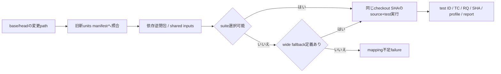

# UT-INVENTORY: 実装unit台帳・test ID・CI・scenario

- 文書版: 1.1
- 状態: 設計承認済み・正本適用済み（2026-10-17）。実装・実行状態は各unitのstateと実行記録で管理
- 文書種別: unit-test設計・契約
- 根拠RQ: [RQ-14-002](../11_requirements/RQ-14_delivery-sequence.md#rq-14-002)、[RQ-14-005](../11_requirements/RQ-14_delivery-sequence.md#rq-14-005)、[RQ-14-011](../11_requirements/RQ-14_delivery-sequence.md#rq-14-011)、[RQ-13-001](../11_requirements/RQ-13_nonfunctional-measurement.md#rq-13-001)、[RQ-13-011](../11_requirements/RQ-13_nonfunctional-measurement.md#rq-13-011)、[RQ-16-003](../11_requirements/RQ-16_document-governance.md#rq-16-003)
- 基本設計: [ビルド環境：toolchain・検証・support](../12_design/build/toolchain-support.md)

本書は承認された具体化の正本である。宣言・型・command・planned pathは設計情報で、配布済みヘッダ・実装済みAPI・試験合格の証拠ではない。将来候補・optional featureは本文で区別し、初期必須へ読み替えない。

## 実現判断

| 設計ID | 実現手段・責務 | 要求根拠 |
| --- | --- | --- |
| <a id="ut-inv-01"></a>UT-INV-01 | 単位IDはUNIT-<domain>-NNN、実testはUT-/REQT-/ABI-/WRAP-/INT-/SYS-/PLAT-/PKG-/REL-/VER-を境界に合わせる。論理TCと別fieldにする。 | 上記の根拠RQ |
| <a id="ut-inv-02"></a>UT-INV-02 | units.yamlにsource/config/generated inputs、depends_on、test command、RQ/DD/SD、logical casesを記録。未作成pathはplanned状態で実行対象と区別する。 | 上記の根拠RQ |
| <a id="ut-inv-03"></a>UT-INV-03 | source変更から依存逆閉包を選択。renameは旧新path、deletionは旧manifestのmapping、shared/config/header変更は該当全suite。 | 上記の根拠RQ |
| <a id="ut-inv-04"></a>UT-INV-04 | pushとpull_requestのchecked-out SHAを同じsource/testへ使う。PR merge commitを試す場合はmerge SHAとhead/base SHAをすべて証跡に記す。 | 上記の根拠RQ |
| <a id="ut-inv-05"></a>UT-INV-05 | Rust cargo test、C/C++ CTest、C# dotnet test、Python pytestを採用。fake host/clock/allocator/OS boundaryで異常注入する。 | 上記の根拠RQ |
| <a id="ut-inv-06"></a>UT-INV-06 | laneはfast-unit、ABI/4wrapper、platform/package、board/releaseに分ける。required checkはselectionと対象fast/ABI結果、releaseは全必須profile。 | 上記の根拠RQ |
| <a id="ut-inv-07"></a>UT-INV-07 | changed mapping、unit/test inventory、実行reportを別schemaで保存。reportにSHA/profile/command/toolchain/artifact digestとassertion結果を持つ。 | 上記の根拠RQ |
| <a id="ut-inv-08"></a>UT-INV-08 | 性能代表入力は計画文書にだけ置く。例として1k/10k items、128/129 delivery items、ASCII/日本語混在を用途付きで記録し、製品上限・合格閾値にしない。 | 上記の根拠RQ |
| <a id="ut-inv-09"></a>UT-INV-09 | CI actionsはfull commit SHA、pull_request_targetでuntrusted codeを実行しない。self-hosted boardは承認済みsourceのみ別queueで実行する。 | 上記の根拠RQ |

## 実現設計

### 開発基盤の現行登録

[tools/units.yaml](../../tools/units.yaml)にschema2のUNIT-BUILD-001を登録した。YAMLのJSON互換記法を使い、開発コマンド・設定・probeと、[bootstrap検証](development-bootstrap.md)の実入口を対応付ける。readyはbootstrapの実在source/commandと実行確認に限り、下記planned例の製品UNIT-CORE-001やUT-CORE-HANDLE-001をreadyへ昇格しない。CIの現状は全bootstrap gateの常時実行で、製品unitのpath選択器は未実装である。

#### Linux Platform backend unit（DD v1.3 / test design 0.5承認済み）

Platform DD 1.3とUI試験設計0.5は2026-10-26に全文承認済みであり、UNIT-CORE-073/074はcomplete。`UNIT-CORE-075`は実装・local検証済みで同revision CI待ちの`ready`。Linux backend 2 unitは未着手の`planned`。各unitは個別の同revision検証完了まで実行済みと扱わない。

| unit | 責務 | test設計 | 状態 |
| --- | --- | --- | --- |
| `UNIT-CORE-073` | Platform factoryとWindow peer lifecycle | `UT-PLATFORM-ADAPTER-001` | complete / local・Windows/Linux CI pass |
| `UNIT-CORE-074` | immutable SceneSnapshotとframe completion | `UT-PLATFORM-FRAME-001` | complete / local・Windows/Linux CI pass |
| `UNIT-CORE-075` | Core render submissionとdispatcher completion接続 | `UT-PLATFORM-RENDER-CORE-001` | complete / local・同revision Windows/Linux CI pass |
| `UNIT-PLATFORM-001` | Linux DRM node/output選択とGBM/EGL surface lifecycle | `UT-PLATFORM-DEVICE-001` | complete / Linux focused 5 tests・Windows/Linux CI pass |
| `UNIT-PLATFORM-002` | Core DeviceScale/背景色に基づくClip/FillRect GLES renderer、DRM page-flip completionとresource loss。GlyphRunは後続 | `UT-PLATFORM-PRESENT-001`、`UT-PLATFORM-LOSS-001`、`UT-PLATFORM-SCALE-CORE-001` | complete / local gates・同SHA Windows/Linux CI pass。実機profileは後続 |

#### Core Layout kernel unit（DD 1.3 / test design 0.7承認済み）

| unit | 責務 | test設計 | 状態 |
| --- | --- | --- | --- |
| `UNIT-CORE-076` | immutable tree snapshotを入力にCore内でMeasure/Arrangeを計算し、成功時のみ同revisionのLayoutSnapshotを一括公開する純粋kernel。Window/Control tree接続、TextService実装、Scene producer、public ABIは含めない | `UT-LAYOUT-001` | complete / focused・whole-crate・Clippy・Rust 1.85 check pass |

`UNIT-CORE-076`は承認済みDD 1.3の純粋計算境界を先行実装する。fake IntrinsicMeasureProviderで寸法・Align・orientation・制約・overflow/error時のsnapshot保持を検証する。Window client-area通知と実Control treeからのsnapshot構築は後続unitとし、このunitのpassをControl表示・Text描画完了として扱わない。

実行記録: `UNIT-CORE-076` / `UT-LAYOUT-001` は `cargo test -p freemvvm-core ui_layout::tests --locked` 4 tests、`cargo test -p freemvvm-core --locked` 164 tests、`cargo clippy -p freemvvm-core --all-targets --locked -- -D warnings`、`cargo +1.85.0 check -p freemvvm-core --all-targets --locked`、`cargo fmt --all -- --check` が実装SHA `4162b7dec89a64429b9a315ceed8b71fa86aa7f0` 上でlocal pass。`tools/check_docs.py`、`tools/units.yaml` JSON parse、`git diff --check` もpass。これは純粋Layout kernelのfake-measurer検証であり、実Control tree接続・Window領域更新・TextService・Scene producer・実機描画の完了を意味しない。

#### Core Window client-area input unit（DD 1.3 / test design 0.7承認済み）

| unit | 責務 | test設計 | 状態 |
| --- | --- | --- | --- |
| `UNIT-CORE-077` | Window peerのopen時DIP領域をgenerationとともにCoreへcommitし、resize通知をUI dispatcher経由で適用する。invalid/stale/closed通知は現状態を壊さない | `UT-LAYOUT-ROOT-001` | ready / 検証済み・実装SHA登録待ち |

このunitはroot領域のSPI・generation/lifecycle接続を対象とする。実Control treeからimmutable LayoutNodeSnapshotを作る統合、TextService計測、Scene producerは後続とし、Platform Adapterの実機動作確認は含めない。

`UNIT-CORE-075`の実装はCore `WindowLifecycle`へFrameTrackerを接続し、peer submit後はcompletionをCore Dispatcherへ投稿してUI turnでticket照合する。focused test、全体check、最低Rust toolchainがlocal pass。同実装SHA `e3d3acdd56d501c208505719b7d7d340e6314454` の[Windows/Linux CI run 40326835471](https://github.com/edamame-edame/freemvvm/actions/runs/40326835471)もsuccess。

`UNIT-PLATFORM-001`は`crates/platform-linux`を追加し、Linux C ABI Runtimeだけがlazy Platform factoryを注入する。DRM nodeはnumeric suffix順、接続済みconnectorではpreferred modeの最小ID、preferredなしなら最大pixel area・同値最小IDを選ぶ。GBM/EGL surface failureはopen failureとして返し、別rendererへのfallbackはしない。Linux CIで`UT-PLATFORM-DEVICE-001`の5 tests、`tools/dev.py check/minimum`がpass。同実装SHA `b53f0f59cdc3569094ab770d719dff20b00ae6ed` の[Windows/Linux CI run 40330710176](https://github.com/edamame-edame/freemvvm/actions/runs/40330710176)もsuccess。CI runnerに`libdrm-dev`と`libgbm-dev`が必要。実機表示・描画/presentは検証していない。

#### C# Property notification Subscriptionの実装記録

`UNIT-WRAP-CS-PROP-SUB-001`を実装完了（`complete`）とし、fake ABI focused test、real C ABI consumer、全体check、minimum Rust toolchainをWindows 11上で通過した。実装commit `59d4dc9ec5cec3cf1315aa6e603b7742624aa6ef` のGitHub Actions [run 40054978936](https://github.com/edamame-edame/freemvvm/actions/runs/40054978936) はWindows/Linux両runnerでsuccess。

| unit | focused test | consumer test | local checks | CI |
| --- | --- | --- | --- | --- |
| `UNIT-WRAP-CS-PROP-SUB-001` | `.venv/Scripts/python.exe tools/dev.py csharp-property-test` 成功 | `.venv/Scripts/python.exe tools/dev.py csharp-property-consumer-test` 成功 | `tools/dev.py check`、`tools/dev.py minimum` 成功 | [Windows/Linux CI success](https://github.com/edamame-edame/freemvvm/actions/runs/40054978936) |
| `UNIT-CORE-067` | `cargo test -p freemvvm-core tree_owner_` 成功（4件） | — | Core 132件、Clippy、fmt成功 | 未確認 |
| `UNIT-CORE-068` | `cargo test -p freemvvm-core tree_owner_tree_` 成功（4件） | — | Core 136件、Clippy、fmt成功 | 未確認 |
| `UNIT-CORE-069` | `cargo test -p freemvvm-core tree_owner_tree_runtime_` 成功（3件） | — | Core 139件、Clippy、fmt、`tools/dev.py check`、`tools/dev.py minimum` 成功 | 未確認 |

### 台帳案

```yaml
schema: 2
units:
  - id: UNIT-CORE-001
    state: planned
    sources: ["crates/core-runtime/src/handle_registry/**"]
    config: ["Cargo.toml", "Cargo.lock"]
    depends_on: []
    design:
      - path: .docs/13_detail_design/runtime-objects/objects-values.md
        version: "1.0"
        section: handle登録と検証
    requirements: ["RQ-04-018", "RQ-05-011"]
    cases: ["TC-CORE-OBJ-01", "TC-LIFE-01"]
    tests:
      - id: UT-CORE-HANDLE-001
        command: ["cargo", "test", "-p", "freemvvm-core", "handle_registry"]
```

上記path/crate/commandは提案構成で現repositoryに実装済みではない。state=plannedはCIのpass対象にならず、unit着手時に実在path/targetへ更新しreadyへ移す。readyに未存在path/commandがあればselection checkを失敗させる。

schema 2の設計根拠は文書パス・対象版・設計項目で指定する。設計判断IDの配列は新規登録しない。要求と実装単位の責務から適用する設計文書を選び、readyにする前に承認範囲と参照先の存在を確認する。実装unit IDとtest/case IDはそのまま使う。

| unit候補 | 前提/操作 | 局所oracle | 上位logical case |
|---|---|---|---|
| Handle/owner | retain/release競合・発行不可注入 | 一参照一消費、他owner不変、failed release token保持 | TC-CORE-OBJ-01/TC-LIFE-01 |
| Dispatcher | enqueue/wake/stoppedをbarrierで競合 | lost wakeなし、callback後shutdown優先、未完了とClosed区別 | TC-THREAD-01 |
| Binding | hash衝突・256履歴・128/129 item | 意味snapshot未一致で停止しない、残件保持 | TC-BIND-01 |
| Collection | batch途中invalid/OOM・Selection同時更新 | revision/値/Selection/通知の全件commitか非変更 | TC-COL-01/TC-SEL-01 |
| TextBox | Commit copy failure・Reject・stale session | snapshot整合、候補回復可否、旧session不適用 | TC-IME-01 |
| wrappers | native call中close・handler交換・Drop/GC失敗 | lease保持、一回回収、元例外を保持 | TC-WRAP-* |
| SecurityVerifier | duplicate/unknown/expiry/鍵失効/cache差替え | invalidをVerifiedArtifact型へ昇格しない | TC-ARTIFACT-01 |



異常scenarioは、入力拒否後の独立更新保持、callback中shutdown、main例外終了、peer再所属失敗、Model batch拒否、artifact失効offlineを別々に組み立てる。test fixtureは共有しても各RQのassertionを省略しない。Release evidenceはCI reportをimmutable identityで参照し、Version testは変更RQと依存逆閉包の回帰を追加する。

運用根拠: [GitHub Actions secure use](https://docs.github.com/en/actions/reference/security/secure-use)。GitHub側の規則と本案のunit選択schemaを別に扱う。


## 承認履歴（具体化適用）

| 日付 | 対象版・範囲 | 承認者 | 結果・根拠 |
| --- | --- | --- | --- |
| 2026-10-17 | 1.0 / UT-INVENTORY / 9判断とinterface・所有・状態遷移 | 利用者 | 全件反映を指示。設計採用・本文適用を承認。実装・公開・試験合格を意味しない |

## 改訂履歴（具体化適用）

| 版 | 日付 | 変更内容 | 作成者 |
| --- | --- | --- | --- |
| 1.0 | 2026-10-17 | UT-INVENTORY / 9判断とinterface・所有・状態遷移を正本へ適用し、旧判断との対応を保持 | Codex |
| 1.1 | 2026-10-17 | 利用者の設計ID追跡廃止指示に従い、適用設計を文書・版・設計項目で示すschema 2へ変更。実装/test IDと実行規則は維持 | Codex |
