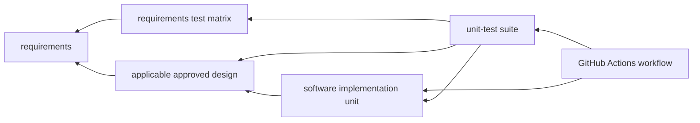

# 実装単位・unit-testの契約

- 文書版: 0.4
- 状態: 契約承認済み（2026-10-17）。workflow/test実装は未完了
- 作成日: 2026-10-12
- 文書種別: 実装とunit-testの対応・継続検証方針

## 1. 目的と上位参照

分野別の具体的な試験設計案は[テスト設計の入口](README.md)にまとめる。各0.1文書は今回作成した未承認案であり、本書の既承認契約やtest実装・実行状態を変更しない。

本書は、実装単位ごとのunit-testを設計・実行し、変更がGitHubにpushまたはpull requestとして届いたときに、対応するテストをGitHub Actionsで検証するための方針案である。実装とunit-testを同じ変更単位で対にし、テスト結果を対象revisionへ結び付ける。

文書参照は上位の仕様をたどる。

- [要求仕様の総目次](../11_requirements/reqirements-specification.md)
- [要求-テストケース対応表](../30_release_test/requirement-test-matrix.md)
- [Release test規約](../30_release_test/release-test.md)
- [Version test規約](../31_version_test/version-test.md)
- [Requirements Test Manifest](../30_release_test/requirements-test-manifest.md)

Requirements Test Manifestは要求case/evidenceの共通ルールである。本書はunit-testの実装方式やtest frameworkをmanifestに追加確定しない。実装単位に適用する承認済み要求・BD/DDと、その意味を確認できるcaseを選ぶ。

## 2. 用語

| 用語 | 本書での意味 |
|---|---|
| 実装単位 | 独立して計画・レビュー・変更・検証できる実装上のまとまり。複数ファイルを含めてもよく、ソースファイル1個とは限らない |
| unit-test設計 | 実装単位について、前提・入力・観測値・期待結果・後始末・実行方法を決めたレビュー可能なtest設計 |
| 対応unit-test | 実装単位の内部ロジックや局所契約を検査し、その単位の変更と同じrevisionで実行するtest群 |
| 影響テスト | 変更ファイルを含む実装単位に加え、依存関係や共有境界の変更によって回帰影響を受けるunit-test・上位test |
| 変更ファイル対応情報 | repository pathから実装単位、test suite、追加の影響テストを特定する管理情報 |

unit-testは要求test・integration/system/release testの代替ではない。unit-testは実装単位を、要求testは各RQの観測可能な充足を、release/version testは用途・変更範囲に応じた全体挙動を検証する。

## 3. 承認済み判断

UT-STR-01～06と本改訂の対応・選択契約は2026-10-17の全案反映指示で承認された。

| ID | 判断案 | 根拠・境界 | 状態 |
|---|---|---|---|
| UT-STR-01 | 実装単位ごとに、実装ID・対象path・適用要求/RQ・設計文書/版/設計項目・unit-test設計ID/test path・実行command・結果を対応づける。IDはUNIT-<domain>-NNN、台帳はimplementation-test-inventoryのschema 2を使う。設計判断IDによる追跡は行わない | 利用者指示。requirementsと設計文書を試験oracleの出典とする | 承認済み契約を継承し、設計参照方式を利用者指示により変更（2026-10-17） |
| UT-STR-02 | 実装単位の実装前または同一作業phaseでunit-testを設計し、実装に対応するtestを駆動・実行する。実装だけが変更され対応testがない状態をCIで見逃さない | 利用者指示。必須TDDサイクルや言語別手法はこの案では決めない | 承認済み（2026-10-17） |
| UT-STR-03 | unit-testの期待結果は承認済み要求/設計から導き、testコードだけを根拠に製品仕様を追加しない。上位で未決の振る舞いは未決のまま記録し、testのpass要件に捏造しない | AGENTS.mdの設計承認境界、RQ/BD/DD | 承認済み（2026-10-17） |
| UT-STR-04 | GitHub Actionsはpushおよびpull request作成・更新で起動し、変更された実装単位のunit-testと影響テストを実行する | 利用者指示。GitHubへ未送信のローカル変更はworkflowの対象外 | 承認済み（2026-10-17） |
| UT-STR-05 | 変更fileから対応する実装単位・testを確定できない場合、無関係として無視せず、対応情報の不足をfailureにするか、安全側の広い検証を実行する | 変更時検証の漏れ防止案。fallbackは台帳に宣言した広域suiteへ限定し、定義がなければmapping failure | 承認済み（2026-10-17） |
| UT-STR-06 | テスト実行結果をcommit SHA、実装単位、test ID、target/profile、resultへ対応づけ、PR上で確認できるようにする | Requirements Test Manifestのcase/evidence記録規則案と利用者指示 | 承認済み（2026-10-17） |

## 4. 実装単位ごとの設計・実行記録

実装単位を着手するとき、最低限以下を設計記録に持たせる。

| 項目 | 記録内容 |
|---|---|
| 実装単位ID / 名称 | 安定したUNIT-<domain>-NNNと目的 |
| 変更path | 主なsource/configuration path。共有fileやgenerated fileの関係も明記 |
| 上位根拠 | 適用RQ、承認済みBD/DD判断、対応するrequirements test case |
| unit-test設計 | test ID、precondition、input/action、observable、oracle、cleanup、境界・失敗系 |
| test実装 | test path/symbolと、使うfixture/test command |
| 実行結果 | commit SHA、target/profile、command、pass/fail/blocked、ログまたはCI runへの参照 |
| 影響範囲 | 変更時に追加で起動する依存・共有契約・回帰test |

実装単位の境界は各言語のmodule、crate/package、ABI domain、platform adapterなどから選ぶ。repositoryの実装構成を確認せず、言語横断でファイル単位に固定しない。未実装段階ではpath・symbol・commandをplaceholderとして管理し、実装開始時に実値へ更新する。

### 4.1 対応台帳の行形式案

実装開始時に以下の一行を実装単位ごとに用意する。現時点では未実装のため実値はない。

| Unit ID | 実装範囲/path | RQ・BD/DD | unit-test design/case ID | test path・command | CI変更path/影響test | 対象revision・結果 |
|---|---|---|---|---|---|---|
| 未採番 | 実装基盤決定後に登録 | 各実装単位の上位根拠 | 設計時に採番 | test実装時に登録 | path対応情報へ登録 | commit SHAとCI結果を記録 |

## 5. 変更ファイルからの検証選択

GitHub Actionsの変更検証は、単に変更ファイル名と同名のtestを探すのではなく、変更pathを実装単位と依存関係へ対応づける。案とする対象は次のとおり。

| 変更対象 | 実行する検証案 |
|---|---|
| 実装source | 対応実装単位のunit-test、依存/共有契約の影響test、該当languageのbuild/lint/type check |
| test source/fixture | 対応suiteを実行し、test discovery・compile・format等を確認 |
| build設定・共有ABI/header・共通runtime | 影響する複数単位を選択。影響を安全に限定できない場合は対象componentの全unit suiteまたは全体suite |
| GitHub Actions・path mapping・test selection設定 | mapping/config validationとworkflowの安全なdry-run相当を行い、selection漏れを検知 |
| 要求・設計・test文書 | Markdown/link/ID/traceability等の文書検査を実行。source unit-testの代替に数えない |
| 対応情報に未登録の変更path | 対応漏れとしてfail、または承認済みfallback suiteを全実行。未検証のままsuccessにしない |

path filterでworkflow自体を起動しない構成は、共通設定やtest selection更新を取りこぼす可能性がある。どのpathでも適切な検証が少なくとも一つ起動するようにする。変更範囲を絞ったunit-testに加え、共有依存に応じた影響回帰を実行し、「変更ファイルだけ」から推測したtest selectionで完了扱いにしない。

## 6. GitHub Actionsの実行点と結果

運用案では、GitHubにpushされたcommitとpull requestの作成・更新を契機にworkflowを起動する。pull request head/baseの差分を調べ、変更path対応情報を使ってunit-testと影響testを選び、結果を対象commit SHAとPR checkへ記録する。merge後のpushでも同じ検証が必要かはbranch protection/release方針と合わせて定める。

GitHub Actionsは未pushのIDE上の編集を検知しない。「リアルタイム」は変更をpushまたはPR更新した後にCI検証を自動開始する意味とする。各変更に追従した結果をPR上で確認でき、必須test failure・selection不明・test未設計は成功へ読み替えない方針を提案する。

現時点でrepositoryに`.github/workflows`、実装source tree、language manifestは確認できていない。このため具体的なworkflow YAML、runner、matrix、test framework/command、path mapping形式、artifact retentionは後続の実装基盤とtooling設計へ送る。

## 7. 上位testとの対応

以下の矢印は、文書・コードが根拠として参照する向きを示す。要求test matrixはRQを参照し、unit-testはmatrix、設計根拠、実装単位を参照する。GitHub Actions設定は実装とunit-testの実行対象を参照する。

RQと論理requirements test caseの対応はrequirements test matrixに保つ。unit-test台帳はその要求・設計caseと実装単位を結ぶ。ひとつのunit-testがrequirement test caseを置き換えたことにはしない。

| 検証レベル | 主な対象 | 結果が示す範囲 |
|---|---|---|
| unit-test | 一つの実装単位と局所契約 | 試験した単位・oracle・revisionの状態 |
| 要求test | RQに対応するobservable/case | 対象要求の検証caseの状態 |
| integration/system/release/version test | 境界をまたぐscenario、support profile、変更影響 | 試験した構成・profile・revisionの範囲 |
| GitHub Actions result | 変更path選択と各test/build/checkの実行結果 | workflowが実行したjob・commit SHAの範囲 |

## 8. 未決事項

- 実装単位ID・unit-test ID・case IDの命名、正本となる対応台帳の形式。
- Rust Core、C ABI、C++/C#/Rust/Python wrapper、platform別のunit境界とshared fixture方針。
- 採用test framework/command、build/lint/type check、coverage指標・閾値の採否。
- GitHub Actionsのrunner、job graph、matrix、cache、parallelism、timeout、artifact保管期間。
- 変更pathと単位/依存関係の対応schema、生成file/vendor file/rename/deletionの扱い。
- selection不能時にfailとする範囲とfallback suiteの粒度。
- branch protectionで必須にするcheck、merge後の再実行、release gateとの統合。
- CI結果からrequirements/unit ledger/evidenceを自動更新するか、人手で記録するか。

## 承認履歴

| 日付 | 対象版・ID / 範囲 | 承認者 | 結果・根拠 |
|---|---|---|---|
| 2026-10-12 | 実装単位ごとのunit-testと変更時GitHub Actions検証の要求 | 利用者 | 今回の指示。設計方針はレビュー案 |
| — | UT-STR-01～06 / unit-test設計案0.1 | — | 未承認。framework・job・mapping実装は未決 |

## 改訂履歴

| 版 | 日付 | 変更内容 | 作成者 | 承認履歴への対応 |
|---|---|---|---|---|
| 0.1 | 2026-10-12 | 実装単位との対応、変更file選択、GitHub Actions起動とevidenceのレビュー案を作成 | Codex | 方針案。未承認 |

## 9. 実装単位の対応台帳と変更選択

| 台帳field | 記録内容 |
| --- | --- |
| unit ID / source/config paths | source file一個に限定せず、独立して動作確認できる実装単位を識別 |
| 適用RQ / DD / SD / logical case | 外部結果と局所不変条件の根拠を別々に記録 |
| UT suite / test ID / command | UT- prefixの実test、実行方法、影響する依存unitを記録 |
| commit SHA / target/profile / result / report | 実装と対応unit-testの同じSHAを検証し、結果をPRへ公開 |

変更pathが未マッピングなら実行可能な広いfallback suiteを選ぶ。fallbackも確定できなければ対応不足としてCIをfailure/blockedにし、成功skipとしない。rename/deletion、生成物・設定変更も対応台帳へ照合する。push/PR時の検証はGitHubへ届いたSHAを対象とし、未push編集のリアルタイム実行を意味しない。runner/framework/coverage閾値は未設計のまま保持する。

## 承認履歴（今回）

| 日付 | 版・対象 | 承認者 | 結果 |
| --- | --- | --- | --- |
| 2026-10-17 | 0.2 / UT-STR-01～06と変更選択・同一SHA契約 | 利用者 | 全案反映指示により承認。実装・実行証跡のない項目は未実装・未実行を維持 |

## 改訂履歴（今回）

| 版 | 日付 | 内容 | 作成者 |
| --- | --- | --- | --- |
| 0.2 | 2026-10-17 | UT-STR-01～06と変更選択・同一SHA契約 | Codex |

## 具体化した実装台帳・変更検証

[実装unit・test inventory](implementation-test-inventory.md)を台帳schema・suite選択・fault injection・同一SHA証拠・CI権限の正本とする。plannedは未実装を示し、readyへの昇格には実在path/commandの確認が必要である。

## 承認履歴（具体化適用）

| 日付 | 対象版・範囲 | 承認者 | 結果・根拠 |
| --- | --- | --- | --- |
| 2026-10-17 | 0.3 / UT-INV-01～09の台帳と変更検証方式 | 利用者 | 全件反映を指示。設計採用・本文適用を承認。実装・公開・試験合格を意味しない |

## 改訂履歴（具体化適用）

| 版 | 日付 | 変更内容 | 作成者 |
| --- | --- | --- | --- |
| 0.3 | 2026-10-17 | UT-INV-01～09の台帳と変更検証方式を正本へ適用し、旧判断との対応を保持 | Codex |
